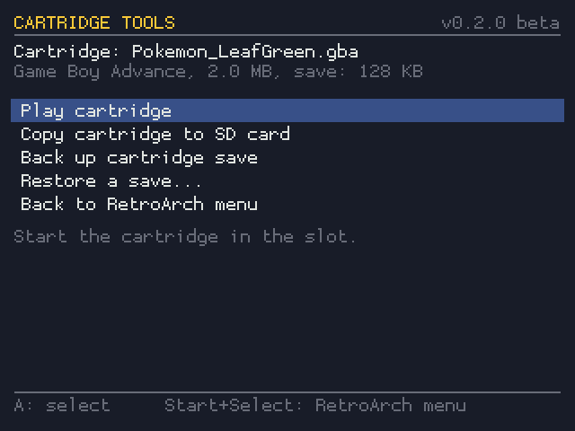

# Retron SQ Custom Firmware

**v0.2.2 beta**: custom firmware for the Hyperkin Retron SQ. Play Game Boy,
Game Boy Color and Game Boy Advance cartridges as before, or ROMs from the SD
card with no cartridge at all, with the full RetroArch menu on Start + Select.


Based on Hyperkin's [hyperkin-gb](https://github.com/hyperkin-game/hyperkin-gb)
firmware source, with the RetroArch menu idea from
[SiirRandall's fork](https://github.com/SiirRandall/sirrandall-hyperkin-gb).
How it all works inside: [docs/DOCUMENTATION.md](docs/DOCUMENTATION.md).
Changing or extending it: [docs/DEVELOPING.md](docs/DEVELOPING.md).

> **Beta:** this firmware hasn't been widely tested on real consoles yet.
> Back up anything important on your SD card first, and please report what
> works and what doesn't.

## What's new

**In v0.2.0:**

| | |
| --- | --- |
| **Hot-swap cartridges** | Insert, pull or swap cartridges while the console is on. Fixes "Copy failed" in Cartridge Tools after a swap. |
| **Auto-load setting** | `CART_AUTOLOAD=0` in `retronsq.cfg` stops an inserted cartridge from starting by itself; play it from Cartridge Tools when you want. |
| **Cartridge first at power-on** | With a cartridge inserted, the console waits for the slot and starts the game; the menu no longer flashes up first. |
| **Safer saves** | In-game saves reach the SD card within 2 seconds, and are written so a power cut can't destroy them. Games are closed with a normal quit, so the save is always written. |
| **Logs for bug reports** | `logs/launcher.log` and `logs/retroarch.log` on the SD card record every cartridge, game and save (with a Pokémon save checker). |

**From v0.1.0:**

| | |
| --- | --- |
| **RetroArch menu** | Start + Select opens it in any game: save states, shaders, settings, load another game. |
| **No cartridge needed** | Without a cartridge the console boots into the menu, with your SD card games listed by system. |
| **Cartridges load instantly** | A cartridge is read once; after that it starts in moments from its copy on the SD card. |
| **Clear loading screen** | The first read of a cartridge shows its name, progress, MB copied and time left. |
| **Cartridge Tools** | Play the cartridge, copy it to the SD card, back up its save, restore a save, all from the menu. |
| **Cartridges are never written to** | The slot is read-only. Saves live on the SD card, with automatic backups of every cartridge save. |
| **FAT32 SD card** | Shows up as **RETRONSQ** on any PC, and grows to fill the whole card (up to 128 GB) on first boot. |
| **Extra emulator cores** | Drop libretro cores onto the card and use them, or make one the default. |
| **Shaders** | 17 GLSL shaders that run on the console's GPU (LCD grids, Game Boy palettes, CRT...). |
| **Reproduction carts** | Tolerant of checksum mismatches, with per-cartridge emulator choice for repros' save chips. |
| **New boot splash** | Shows the firmware version. |

## Installing

1. Download `RetronSQ-CFW-v<version>-sdcard.zip` from
   [Releases](https://github.com/slurrps-mcgee/slurrps-hyperkin-gb/releases)
   (or [build it](#building)) and unzip it.
2. Write the `.img` to the console's microSD card with a USB card reader:
   - **Fedora/GNOME:** open *Disks*, select the card, ⋮ → *Restore Disk Image…*
   - **Any OS:** balenaEtcher (or Rufus on Windows)
   - **Terminal:** `sudo dd if=RetronSQ-CFW-v0.2.2-sdcard.img of=/dev/sdX bs=4M conv=fsync status=progress`
     (find `/dev/sdX` with `lsblk` first; it gets overwritten)
3. Put the card in the console and switch it on.

**The first boot finishes the installation.** Right after writing, the card's
games partition is only about 65 MB, and the rest shows as unallocated on a
PC. That's expected. On its first boot the console grows the partition to the
end of the card (any size up to 128 GB), formats it FAT32 and may restart once
by itself. After that, the card shows up on a PC as **RETRONSQ** with its full
size.

If the RETRONSQ drive is still small after the console has booted, open
`logs/boot.log` on it: it says what the first boot found and did. Please
include it when reporting a problem.

Upgrading from the stock firmware needs this full image: the games partition
changed from ext2 to FAT32.

## The RETRONSQ drive

Put the console's SD card in a PC (after its first boot) and open the
**RETRONSQ** drive:

```
RETRONSQ/
├── roms/                  ← YOUR GAMES GO HERE
│   ├── gba/               Game Boy Advance  (.gba, or .zip)
│   ├── gbc/               Game Boy Color    (.gbc, or .zip)
│   └── gb/                Game Boy          (.gb, or .zip)
├── retroarch/
│   ├── cores/             ← EXTRA EMULATOR CORES GO HERE (*_libretro.so)
│   ├── shaders/           shaders (.glslp presets and .glsl files)
│   ├── system/            BIOS files, optional (gba_bios.bin, gb_bios.bin, gbc_bios.bin)
│   ├── autoconfig/        controller layouts
│   ├── playlists/         game lists, made automatically
│   └── retroarch.cfg      RetroArch's settings (change them from its menu)
├── rom/                   copies of your cartridges + their saves (automatic)
├── saves/                 save backups, one folder per game (automatic)
├── logs/                  what the console did (include these in bug reports)
├── retronsq.cfg           firmware settings
├── cart-overrides.txt     pick the emulator for one cartridge
└── README.txt             short guide
```

Factory files deleted from the card (settings, shaders, controller layouts)
are put back at the next boot. Your own files are never touched.

### ROMs

Copy games into the folder of their system: `roms/gba`, `roms/gbc` or
`roms/gb`. Subfolders are fine. A `.zip` must hold one game and sit in the
folder of its system. Saves and save states are written next to each game.
New games appear in the menu on the next boot.

### Emulator cores

The firmware comes with three cores: **gpSP** (fast GBA, the default for
GBA), **mGBA** (accurate GBA/GB/GBC) and **VBA-M** (GB/GBC default). To add
another:

1. Download the core for **Linux armhf** from libretro's buildbot
   (`buildbot.libretro.com`, under `linux/armhf`), e.g.
   `gambatte_libretro.so.zip`, and unzip it.
2. Copy `gambatte_libretro.so` into `retroarch/cores/`.
3. Optional: copy its `gambatte_libretro.info` from libretro's
   [core info files](https://github.com/libretro/libretro-core-info) next to
   it, so RetroArch shows its proper name and file types.
4. Use it from the menu (*Load Core*, or pick it when opening a file from
   *Start directory*), or make it the default for a system in `retronsq.cfg`,
   e.g. `GB_CORE=gambatte`.

The console runs RetroArch 1.7.4 on glibc 2.26 with a 32-bit ARM Cortex-A7.
Very recent core builds may not load: if one doesn't, try a build from around
2018–2019. Cores for other consoles (NES, SNES, Master System...) can also be
loaded through *Load Content → Start directory*, as long as the CPU is fast
enough for them.

### Shaders and BIOS

- **Shaders:** in a game, Start + Select → *Quick Menu → Shaders*. Light
  single-pass GLSL shaders work best. More can be copied into
  `retroarch/shaders/`.
- **BIOS:** not needed (gpSP has a built-in open BIOS), but real BIOS files
  in `retroarch/system/` are used if present.

## Playing

**A cartridge is loaded immediately.** Whenever a cartridge is detected, at
power-on or inserted while the console runs (even during an SD card game),
the console closes what's running and starts the cartridge. The running
game's save is written before it closes. Pulling the cartridge returns to
the menu, and swapping it for another starts the new one.

Cartridges are **hot-pluggable**: insert, pull and swap them with the
console on. To have an inserted cartridge wait instead of starting by
itself, set `CART_AUTOLOAD=0` in `retronsq.cfg`; then start it with
**Cartridge Tools → Play cartridge**.


**The first time a cartridge is played** it's copied to the SD card, with the
loading screen above showing progress and time left. The cartridge slot is
a USB 1.1 device that reads about **1 MB per second**, so a big GBA game
takes 15–35 seconds the first time. That's the slot's hardware limit. After
that the cartridge starts in moments from its copy, as long as it hasn't
changed.

**With no cartridge**, the console boots into the RetroArch menu:

- **Load Content → Collections** lists your games by system (*Nintendo -
  Game Boy Advance*, *... Color*, *... Game Boy*), *Cartridge Dumps* (every
  cartridge played before, playable without it) and *Cartridge Tools*.
- **Load Content → Start directory** opens the `roms` folder to browse it.
- **Load Recent** lists the games played last.

### Controls

| Buttons | Action |
| --- | --- |
| **Start + Select** | Open the RetroArch menu in a game: save/load state, shaders, settings, *Close Content* to pick another game |
| **Reset button** | Restart the game (or the menu) |
| D-pad, A / B | Navigate the menu, confirm / back |

### Cartridge Tools



**Load Content → Collections → Cartridge Tools** (also under *Load Recent*
after the first use). From a cartridge game: Start + Select → *Close
Content*, then open it from the menu.

| Option | What it does |
| --- | --- |
| **Play cartridge** | Start the cartridge in the slot (also with `CART_AUTOLOAD=0`). |
| **Copy cartridge to SD card** | Dump the game into `roms/<system>/` with its save, so it plays without the cartridge. Checked against the cartridge's checksum; a game already there isn't copied twice. |
| **Back up cartridge save** | Dump the cartridge's save into `saves/<game>/`. |
| **Restore a save...** | Choose which save to use when playing the cartridge: any backup, or the save on the cartridge now. The save it replaces is backed up first. |

### Saves are kept on the SD card only

**The console never writes to a cartridge.** The cartridge reader is mounted
read-only and its device is locked read-only, so nothing can change a
cartridge or its save.

- The first time a cartridge is played, its save is copied to the SD card
  (`rom/<game>.srm`). From then on every save goes there.
- Each time a cartridge is inserted, its save is backed up to
  `saves/<game>/` (`001-cartridge.sav`, `002-cartridge.sav`...) if it differs
  from the backups already there. If you play the cartridge on a real Game
  Boy in between, nothing is lost.
- To go back to the save on the cartridge, use **Cartridge Tools → Restore a
  save... → Save on the cartridge now**.
- In-game saves are written to the SD card within about 2 seconds, in a way
  that a power cut can't corrupt (the old save stays until the new one is
  complete). Still, give it a few seconds after saving before switching off.

**If a game says its save is corrupted**, nothing is lost: every save the
cartridge ever had is in `saves/<game>/`. Use **Restore a save...** to pick
an older one. Then please report it with `logs/launcher.log` and
`logs/retroarch.log` from the SD card: for each run they record the save's
size and checksum before and after, and for Pokémon Ruby, Sapphire, Emerald,
FireRed and LeafGreen whether each of the two save slots is intact.

### Settings: `retronsq.cfg`

| Setting | Default | Meaning |
| --- | --- | --- |
| `GBA_CORE` / `GBC_CORE` / `GB_CORE` | `gpsp` / `vbam` / `vbam` | Emulator core per system, for cartridges and SD card games |
| `NO_CART` | `menu` | `none`: blank screen without a cartridge, like the stock firmware |
| `CART_AUTOLOAD` | `1` | `0`: an inserted cartridge doesn't start by itself (use *Play cartridge*) |
| `CART_WAIT` | `25` | At power-on, seconds after switching on to wait for a cartridge before showing the menu |
| `RESET_REDUMP` | `0` | `1`: the reset button re-reads the whole cartridge |
| `VERIFY_CACHE` | `0` | `1`: re-check a cartridge's copy on every start (slower) |
| `VERBOSE` | `1` | Detailed RetroArch log (`logs/retroarch.log`) |

`cart-overrides.txt` picks a core for one cartridge (`Game_Name.gba=mgba`),
which helps reproduction carts whose save chip differs from the original.

### Flash cartridges

Menu-based flash cartridges (EverDrive, EZ-Flash, and similar) can't work on
this hardware. The console never runs the cartridge itself: the reader copies
the ROM to a file and RetroArch emulates that file, so a flash cart's menu
would run without the flash cart's hardware behind it. Put the games in
`roms/` instead. Single-game flash carts and reproduction carts load like any
other cartridge.

## Reporting problems

Please open an issue with what happened and the files from `logs/` on the
SD card:

- `launcher.log`: cartridges inserted and removed, games started (with which
  emulator), save checks before and after each game
- `retroarch.log`: RetroArch's log of the last cartridge game
- `boot.log`: what the last boot did with the SD card

## Building

### On your PC

Any Linux with **podman** or **docker** (Fedora, Ubuntu, Arch...):

```
./build-in-container.sh
```

The output is in `rockdev/`: `RetronSQ-CFW-v<version>-sdcard.img` (and
`.zip`) for the SD card, and `update.img` for Rockchip's RKDevTool.

- This 2018 SDK can't be built with a modern distro's compiler, and its
  scripts break on paths with spaces. So the stock `./build.sh` runs inside
  an Ubuntu 18.04 container (`docker/Containerfile`) with this checkout at
  `/work`. No root needed.
- The first run builds the container image (a few minutes); a full build
  takes 1–2 hours, later builds are incremental.
- Any `build.sh` target works: `./build-in-container.sh kernel`,
  `./build-in-container.sh shell` for a shell in the build environment...
- One build at a time per checkout.
- `./build-in-container.sh test` runs the tests (a few minutes, no console
  needed). They also run on GitHub on every push.
- macOS/Windows need a Linux VM (Buildroot needs a case-sensitive
  filesystem).

### Versions and releases

The version is in the [`VERSION`](VERSION) file. It appears on the boot
splash, the loading screen, Cartridge Tools and the image names. While the
major version is 0, "beta" is added automatically.

To publish a release from GitHub: **Actions → Build firmware release → Run
workflow**, and enter the version (e.g. `0.2.0`). It builds the firmware the
same way (2–3 hours) and creates the release `v0.2.0` with the SD card zip,
`update.img` and checksums. 0.x versions are marked as pre-releases. The
build log and images are also kept as a workflow artifact for 14 days.
