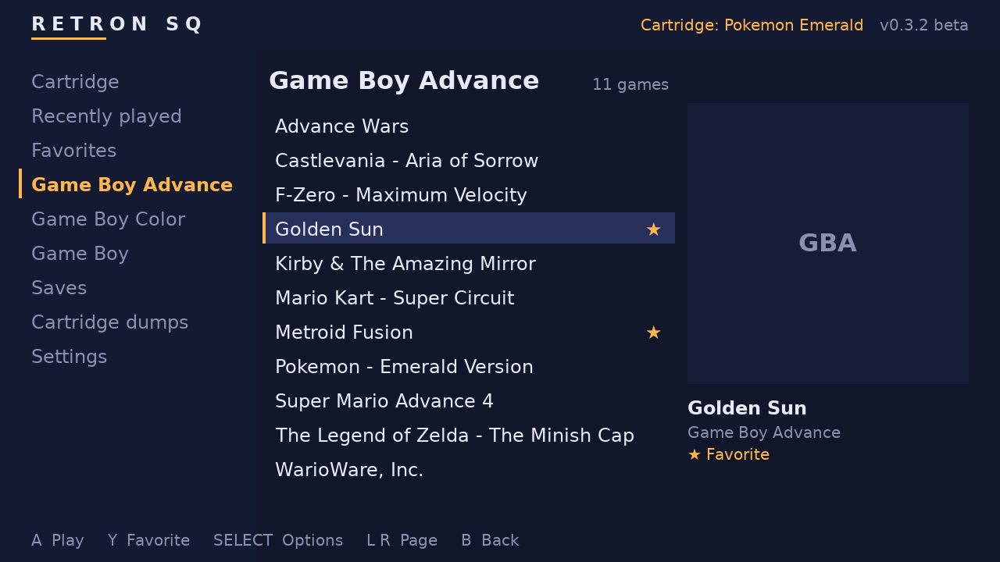
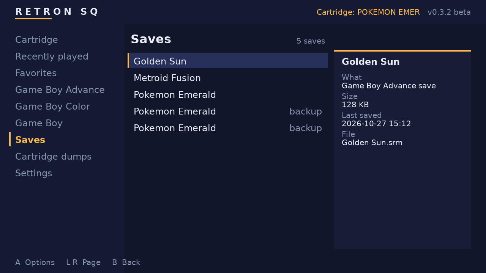
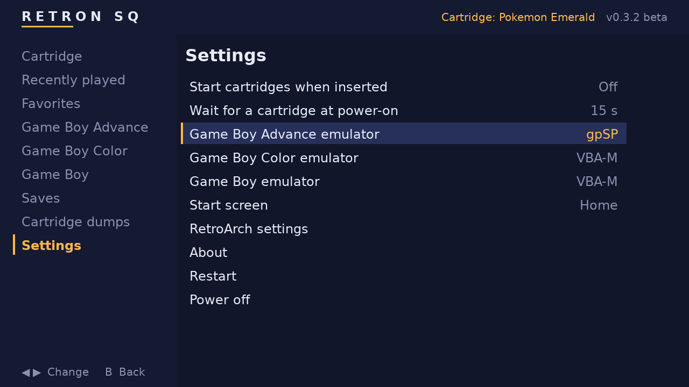
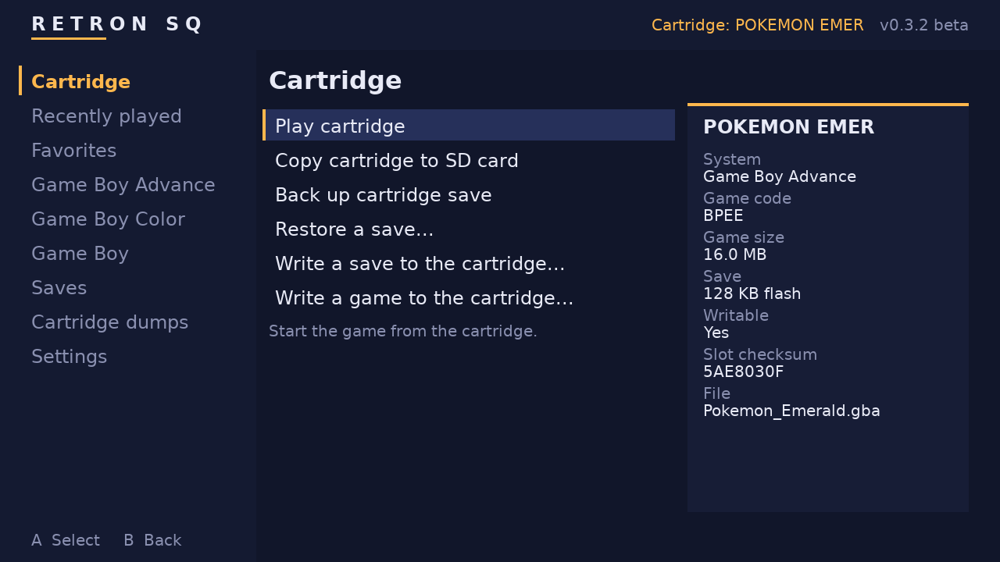

# Retron SQ Custom Firmware

**v0.3.2 beta**: custom firmware for the Hyperkin Retron SQ. Play Game Boy,
Game Boy Color and Game Boy Advance cartridges as before, or ROMs from the SD
card with no cartridge at all, from a simple home screen, with the full
RetroArch menu on Start + Select in any game.



Based on Hyperkin's [hyperkin-gb](https://github.com/hyperkin-game/hyperkin-gb)
firmware source, with the RetroArch menu idea from
[SiirRandall's fork](https://github.com/SiirRandall/sirrandall-hyperkin-gb).
How it all works inside: [docs/DOCUMENTATION.md](docs/DOCUMENTATION.md).
Changing or extending it: [docs/DEVELOPING.md](docs/DEVELOPING.md).

> **Beta:** this firmware hasn't been widely tested on real consoles yet.
> Back up anything important on your SD card first, and please report what
> works and what doesn't.

## What's new

**In v0.3.2:**

| | |
| --- | --- |
| **"Reading cartridge..."** | The top right of the home screen says when the slot is reading an inserted cartridge, then shows its name. |
| **Cartridge details** | The Cartridge page shows what the cartridge is next to its tools: system, game code, size, save type, whether it's writable, the slot's checksum. |
| **Writable or not** | Options that write to the cartridge are greyed out (with the reason) when the slot reports it as write protected. |
| **Write a game to the cartridge** *(experimental)* | Put a game from `roms/` onto a rewritable (flash) cartridge. See [below](#writing-a-game-to-the-cartridge-experimental). |
| **Progress for everything** | Backing up, restoring and writing saves show the same progress as copying a cartridge: KB or MB done, speed, time left, and what step it's on. |
| **Saves page** | Every save on the SD card in one list: the saves games play with, cartridge saves and backups, with size and date. |
| **Delete games and saves** | **Select** on a game opens its options (play, favorite, delete); on the Saves page, **A** or **Select** deletes a save or backup. |
| **Fewer false checksum alarms** | A cartridge whose checksum doesn't match the slot's but reads exactly the same twice is trusted, not flagged. See [Checksums](#checksums). |

**In v0.3.1:**

| | |
| --- | --- |
| **Box art next to the game** | Put a `.png` with the game's name next to it (`roms/gba/Golden Sun.png`); RetroArch's thumbnail packs work too. See [Box art](#box-art). |
| **Home screen shows at once** | It no longer stays black until a button is pressed, at power-on or after leaving a game. |
| **Reliable pad** | The home screen uses the pad exactly as RetroArch does (its `Hyperkin_SQ.cfg` profile), and quick taps on the D-pad are never missed. |
| **Clear questions** | Questions have real *No* / *Yes* buttons (No is the default), messages an *OK* button. |
| **Copy progress** | Copying a cartridge to the SD card shows MB copied, speed and time left, like the loading screen, then *Done* and where it went. The loading screen shows the speed now too. |
| **Cartridge write check** | After writing a save to a cartridge, putting the cartridge back in tells you whether the save really is on it. |
| **Faster boot** | Without a cartridge the home screen comes up about 10 seconds sooner (`CART_WAIT` is now 15 s after power-on). |
| **Splash at power-on only** | The boot splash no longer flashes up between the loading screen, games and the home screen. |
| **Boot timings in the logs** | `boot.log` and `launcher.log` record how long each step of the boot took. |

**In v0.3.0:**

| | |
| --- | --- |
| **Home screen** | A light, quick home screen: your games by system, recently played, favorites, box art, the cartridge with its tools, and settings. RetroArch now only plays games; *Close Content* returns home. |
| **Settings on the console** | Auto-load, cartridge wait, emulator per system and the start screen can be changed on the home screen, no PC needed. |
| **Auto-load, once** | A cartridge starts when it's inserted; leaving its game returns home instead of starting it again. |
| **Reset button for SD games** | The reset button restarts games from the SD card too. |

**In v0.2.2:**

| | |
| --- | --- |
| **Hot-swap cartridges** | Insert, pull or swap cartridges while the console is on. Fixes "Copy failed" in Cartridge Tools after a swap. |
| **Auto-load setting** | `CART_AUTOLOAD=0` in `retronsq.cfg` stops an inserted cartridge from starting by itself; play it from Cartridge Tools when you want. |
| **Cartridge first at power-on** | With a cartridge inserted, the splash stays up until the cartridge is found and starts; the menu no longer shows first. |
| **Write a save to the cartridge** *(experimental)* | New Cartridge Tools option: put the save you play with (or any backup) onto the cartridge itself, to take it to a real Game Boy. Backed up first and checked after. |
| **Safer saves** | In-game saves reach the SD card within 2 seconds, and are written so a power cut can't destroy them. Games are closed with a normal quit, so the save is always written. |
| **SD card fills the card** | The RETRONSQ drive now really grows to the card's full size on first boot (earlier versions grew the partition but not the drive). |
| **Loading never hangs** | A cartridge that stops answering gives up after 30 s and shows the menu, instead of a frozen loading screen. |
| **Logs for bug reports** | `logs/launcher.log` and `logs/retroarch.log` on the SD card record every cartridge, game, copy and save (with a Pokémon save checker), and survive pulling the power. |
| **Tests** | Every part of the firmware is tested automatically on each change. |

v0.2.0 and v0.2.1 were test builds that never got a release: RetroArch
froze on start in both. Use v0.2.2 or later.

**From v0.1.0:**

| | |
| --- | --- |
| **RetroArch menu** | Start + Select opens it in any game: save states, shaders, settings, load another game. |
| **No cartridge needed** | Without a cartridge the console boots into the menu, with your SD card games listed by system. |
| **Cartridges load instantly** | A cartridge is read once; after that it starts in moments from its copy on the SD card. |
| **Clear loading screen** | The first read of a cartridge shows its name, progress, MB copied and time left. |
| **Cartridge Tools** | Play the cartridge, copy it to the SD card, back up its save, restore a save, all from the menu. |
| **Cartridges are read-only** | Saves live on the SD card, with automatic backups of every cartridge save. (The deliberate exceptions: *Write a save / a game to the cartridge*, when you ask.) |
| **FAT32 SD card** | Shows up as **RETRONSQ** on any PC, and grows to fill the whole card (up to 128 GB) on first boot. |
| **Extra emulator cores** | Drop libretro cores onto the card and use them, or make one the default. |
| **Shaders** | 17 GLSL shaders that run on the console's GPU (LCD grids, Game Boy palettes, CRT...). |
| **Reproduction carts** | Tolerant of checksum mismatches, with per-cartridge emulator choice for repros' save chips. |
| **New boot splash** | Shows the firmware version. |

## Installing

1. Download `RetronSQ-CFW-v<version>-sdcard.zip` from
   [Releases](https://github.com/slurrps-mcgee/slurrps-hyperkin-gb/releases)
   (or [build it](#building)) and unzip it.
2. Write the `.img` to the console's microSD card with a USB card reader:
   - **Fedora/GNOME:** open *Disks*, select the card, ⋮ → *Restore Disk Image…*
   - **Any OS:** balenaEtcher (or Rufus on Windows)
   - **Terminal:** `sudo dd if=RetronSQ-CFW-v0.3.2-sdcard.img of=/dev/sdX bs=4M conv=fsync status=progress`
     (find `/dev/sdX` with `lsblk` first; it gets overwritten)
3. Put the card in the console and switch it on.

**The first boot finishes the installation.** Right after writing, the card's
games partition is only about 65 MB, and the rest shows as unallocated on a
PC. That's expected. On its first boot the console grows the partition to the
end of the card (any size up to 128 GB), formats it FAT32 and may restart once
by itself. After that, the card shows up on a PC as **RETRONSQ** with its full
size.

If the RETRONSQ drive is still small after the console has booted, open
`logs/boot.log` on it: it says what the first boot found and did. Please
include it when reporting a problem.

Upgrading from the stock firmware needs this full image: the games partition
changed from ext2 to FAT32.

## The RETRONSQ drive

Put the console's SD card in a PC (after its first boot) and open the
**RETRONSQ** drive:

```
RETRONSQ/
├── roms/                  ← YOUR GAMES GO HERE
│   ├── gba/               Game Boy Advance  (.gba, or .zip; + .png box art)
│   ├── gbc/               Game Boy Color    (.gbc, or .zip)
│   └── gb/                Game Boy          (.gb, or .zip)
├── retroarch/
│   ├── cores/             ← EXTRA EMULATOR CORES GO HERE (*_libretro.so)
│   ├── shaders/           shaders (.glslp presets and .glsl files)
│   ├── system/            BIOS files, optional (gba_bios.bin, gb_bios.bin, gbc_bios.bin)
│   ├── autoconfig/        controller layouts
│   ├── thumbnails/        box art, RetroArch's layout (see Box art)
│   ├── playlists/         game lists, made automatically
│   └── retroarch.cfg      RetroArch's settings (change them from its menu)
├── rom/                   copies of your cartridges + their saves (automatic)
├── saves/                 save backups, one folder per game (automatic)
├── logs/                  what the console did (include these in bug reports)
├── home/                  recently played and favorites (automatic)
├── retronsq.cfg           firmware settings
├── cart-overrides.txt     pick the emulator for one cartridge
└── README.txt             short guide
```

Factory files deleted from the card (settings, shaders, controller layouts)
are put back at the next boot. Your own files are never touched.

### ROMs

Copy games into the folder of their system: `roms/gba`, `roms/gbc` or
`roms/gb`. Subfolders are fine. A `.zip` must hold one game and sit in the
folder of its system. Saves and save states are written next to each game.
New games show up on the home screen as soon as you open their page.

### Box art

The home screen shows a picture of the selected game. Put PNG images on the
SD card in either place:

1. **Next to the game, with the same name** (simplest):

   ```
   roms/gba/Golden Sun.gba
   roms/gba/Golden Sun.png      <- its box art
   ```

2. **In RetroArch's thumbnail folders**, so RetroArch's thumbnail packs
   (for example from [libretro-thumbnails](https://github.com/libretro-thumbnails))
   work as they are:

   ```
   retroarch/thumbnails/Nintendo - Game Boy Advance/Named_Boxarts/Golden Sun.png
   retroarch/thumbnails/Nintendo - Game Boy Color/Named_Boxarts/...
   retroarch/thumbnails/Nintendo - Game Boy/Named_Boxarts/...
   ```

   The name is the game's name as the home screen shows it, with
   `` & * / : ` < > ? \ | `` replaced by `_`. The folders are already
   on the card, with a `README.txt`.

A picture next to the game wins when both exist. PNG only; any size works,
but around 512×512 or smaller loads fastest on the console. For cartridges
(in *Cartridge dumps* and *Recently played*), put the picture next to their
copy in `rom/`: `rom/Pokemon_Emerald.png`.

### Emulator cores

The firmware comes with three cores: **gpSP** (fast GBA, the default for
GBA), **mGBA** (accurate GBA/GB/GBC) and **VBA-M** (GB/GBC default). To add
another:

1. Download the core for **Linux armhf** from libretro's buildbot
   (`buildbot.libretro.com`, under `linux/armhf`), e.g.
   `gambatte_libretro.so.zip`, and unzip it.
2. Copy `gambatte_libretro.so` into `retroarch/cores/`.
3. Optional: copy its `gambatte_libretro.info` from libretro's
   [core info files](https://github.com/libretro/libretro-core-info) next to
   it, so RetroArch shows its proper name and file types.
4. Pick it on the home screen (*Settings → Game Boy emulator* and so on),
   or set it in `retronsq.cfg`, e.g. `GB_CORE=gambatte`. In RetroArch's
   menu it's under *Load Core*.

The console runs RetroArch 1.7.4 on glibc 2.26 with a 32-bit ARM Cortex-A7.
Very recent core builds may not load: if one doesn't, try a build from around
2018–2019. Cores for other consoles (NES, SNES, Master System...) can also be
loaded through *Load Content → Start directory*, as long as the CPU is fast
enough for them.

### Shaders and BIOS

- **Shaders:** in a game, Start + Select → *Quick Menu → Shaders*. Light
  single-pass GLSL shaders work best. More can be copied into
  `retroarch/shaders/`.
- **BIOS:** not needed (gpSP has a built-in open BIOS), but real BIOS files
  in `retroarch/system/` are used if present.

## Playing

**A cartridge is loaded immediately.** Whenever a cartridge is detected, at
power-on or inserted while the console runs (even during an SD card game),
the console closes what's running and starts the cartridge. The running
game's save is written before it closes. Leaving the game (Start + Select →
*Close Content*) or pulling the cartridge returns to the home screen, and
swapping it for another starts the new one.

Cartridges are **hot-pluggable**: insert, pull and swap them with the
console on. To have an inserted cartridge wait instead of starting by
itself, switch off *Settings → Start cartridges when inserted*; then start
it from the home screen's **Cartridge** page.


**The first time a cartridge is played** it's copied to the SD card, with the
loading screen above showing progress and time left. The cartridge slot is
a USB 1.1 device that reads about **1 MB per second**, so a big GBA game
takes 15–35 seconds the first time. That's the slot's hardware limit. After
that the cartridge starts in moments from its copy, as long as it hasn't
changed.

### The home screen

**With no cartridge**, the console starts on the home screen. On the left
are its pages; Up/Down picks one and A (or Right) goes in:

| Page | What's there |
| --- | --- |
| **Cartridge** | The inserted cartridge's tools (below), and what it is |
| **Recently played** | The last 30 games, cartridges included |
| **Favorites** | Games you marked with **Y** |
| **Game Boy Advance**, **Color**, **Game Boy** | Your games from `roms/` on the SD card |
| **Saves** | Every save: the ones games play with, cartridge saves, and backups |
| **Cartridge dumps** | Every cartridge played before, playable without it |
| **Settings** | See below |

In a list, **A** plays the game, **Y** marks it as a favorite (★),
**Select** opens its options (*Play*, *Add to favorites*, *Delete game...*),
**L/R** jump a page, **B** or Left goes back. Deleting a game keeps its
saves. On the **Saves** page, **A** or **Select** offers to delete a save
or backup; a save a game plays with is asked about twice.

 The selected game's picture shows on
the right (see [Box art](#box-art)). Questions have **No** / **Yes**
buttons: pick with Left/Right, press A (No is always selected first, B
always means No). The home screen only redraws when something changes, so
it leaves the console's CPU idle.



| Setting | |
| --- | --- |
| **Start cartridges when inserted** | On: an inserted cartridge starts at once. Off: it waits on the Cartridge page |
| **Wait for a cartridge at power-on** | How long the splash waits for a cartridge before the home screen shows |
| **Game Boy Advance / Color / Game Boy emulator** | The core for each system: gpSP, mGBA, VBA-M, or any core in `retroarch/cores` |
| **Start screen** | *Home*, or *RetroArch menu* to start in RetroArch's own menu as in v0.2 |
| **RetroArch settings** | RetroArch's full menu, for video, audio, shaders, controls... |
| **About**, **Restart**, **Power off** | |

### Controls

| Buttons | Action |
| --- | --- |
| **Start + Select** | Open the RetroArch menu in a game: save/load state, shaders, settings, *Close Content* to go back home |
| **Reset button** | Restart the game |
| D-pad, A / B, Y, Select, L / R | Home screen: move, open / back, favorite, options, page |

The home screen uses RetroArch's own controller profiles
(`retroarch/autoconfig`), so a pad works the same in both.

### Cartridge tools



On the home screen's **Cartridge** page, with what the cartridge is on the
right: system, game code, size, save type, whether it's writable, and the
slot's checksum. While the slot is still reading a cartridge, the top right
of the screen says *Reading cartridge...*. (With *Start screen* set to
*RetroArch menu*, the same tools, except writing a game, are under **Load
Content → Collections → Cartridge Tools**.)

Options that can't work on this cartridge are greyed out, and the line
under them says why: writing when the slot reports the cartridge as write
protected, save options when it has no save. Everything that takes a while
shows its progress: KB or MB done, speed, time left, and the step it's on.

| Option | What it does |
| --- | --- |
| **Play cartridge** | Start the cartridge in the slot (also with `CART_AUTOLOAD=0`). |
| **Copy cartridge to SD card** | Dump the game into `roms/<system>/` with its save, so it plays without the cartridge. Shows MB copied, speed and time left, then *Done* and where it went. Checked against the cartridge's checksum (see [Checksums](#checksums)); a game already there isn't copied twice. |
| **Back up cartridge save** | Dump the cartridge's save into `saves/<game>/`. |
| **Restore a save...** | Choose which save to use when playing the cartridge: any backup, or the save on the cartridge now. The save it replaces is backed up first. |
| **Write a save to the cartridge...** *(experimental)* | Put a save onto the cartridge itself: the one you play with now, or any backup. See below. |
| **Write a game to the cartridge...** *(experimental)* | Put a game from `roms/` onto a rewritable (flash) cartridge. See below. |

### Checksums

The cartridge slot gives a checksum of the cartridge's game (the `.crc`
file next to the game on its drive, shown on the Cartridge page). The
console computes the same kind of checksum of what it reads (the slot's own
CRC-32 variant, taken from the stock firmware) and compares the two:

- **They match:** the copy is exact.
- **They don't match, but a second read gives exactly the same data:** the
  copy is kept and trusted (*"Checked by reading it twice"*). A dirty
  contact makes reads differ from each other; a mismatch that repeats
  exactly means it's the slot's checksum that disagrees, which happens with
  some genuine cartridges.
- **The two reads differ:** the copy is kept so the game runs, and the
  message asks you to clean the cartridge's contacts and copy again.

Every mismatch is logged in `logs/launcher.log` with both checksums and the
game's size. The stock firmware did the same check but never told you: it
silently copied the cartridge again on every start.

### Saves are kept on the SD card

**Playing never writes to a cartridge.** The cartridge reader is mounted
read-only and its device is locked read-only, so nothing can change a
cartridge or its save, except *Write a save (or a game) to the cartridge*
when you ask for it.

- The first time a cartridge is played, its save is copied to the SD card
  (`rom/<game>.srm`). From then on every save goes there.
- Each time a cartridge is inserted, its save is backed up to
  `saves/<game>/` (`001-cartridge.sav`, `002-cartridge.sav`...) if it differs
  from the backups already there. If you play the cartridge on a real Game
  Boy in between, nothing is lost.
- To go back to the save on the cartridge, use **Cartridge → Restore a
  save... → Save on the cartridge now**.
- The **Saves** page on the home screen lists them all, and can delete a
  save or a backup you no longer want.
- In-game saves are written to the SD card within about 2 seconds, in a way
  that a power cut can't corrupt (the old save stays until the new one is
  complete). Still, give it a few seconds after saving before switching off.

### Writing a save to the cartridge (experimental)

To take your progress to a real Game Boy, **Cartridge → Write a save
to the cartridge...** puts a save onto the cartridge itself. Pick *The save
you play with now* or a backup, and confirm twice (move to *Yes* / *Write
it* and press A; *No* is always the default).

- **Before writing**, the cartridge's current save is backed up to
  `saves/<game>/`, so you can always get it back (*Restore a save...*).
- **Refused, with nothing changed**, when: the cartridge slot reports the
  cartridge as write-protected, the save is a different size from the
  cartridge's, or it's a Pokémon Ruby/Sapphire/Emerald/FireRed/LeafGreen
  save that doesn't check out.
- The cartridge is unlocked only for this write and locked again right
  after. Only the save file is written, in place; the game itself isn't
  touched. Afterwards the save is read back from the cartridge and compared.
- **Checked when you put it back.** A cartridge slot can accept a write,
  and even read it back, without storing it on the cartridge. So after
  "Written to the cartridge", **take the cartridge out and put it back
  in**: the console then reads the cartridge's save again and tells you
  either *"Your save is on the cartridge"* or *"The cartridge still has its
  old save"* (the slot doesn't store writes; nothing was lost). The answer
  is also in `logs/launcher.log` ("write check"), and it works after a
  power-off too.
- **Experimental:** the stock firmware never wrote to cartridges, and it's
  not known yet whether the Retron SQ's cartridge slot passes writes on to
  the cartridge's save chip. Please report what the check says.
- Don't remove the cartridge or switch off while it writes.

### Writing a game to the cartridge (experimental)

**Cartridge → Write a game to the cartridge...** puts a game from `roms/`
onto the cartridge in the slot. It's meant for rewritable (flash)
cartridges: an original cartridge's game is on a read-only chip and can't
be replaced.

- Only games that can fit are offered: a `.gba` for a Game Boy Advance
  cartridge, a `.gb` / `.gbc` for a Game Boy one, no bigger than the
  cartridge's game (the cartridge's drive can't grow). Unzip a `.zip` first.
- It replaces the cartridge's game: **copy the cartridge to the SD card
  first** if you want to keep it. Its save is backed up automatically.
- Confirmed twice, greyed out when the slot is write protected, and done
  like a save write: unlocked only for the write, written in place, read
  back and compared, locked again.
- **Checked when you put it back:** the cartridge may come back under the
  new game's name; the console compares the start of whatever is inserted
  with the game written and says *"The game is on the cartridge"* or *"The
  cartridge still has its old game"*.
- **Experimental:** whether the slot passes these writes on to a flash
  cartridge isn't known yet. Please report what happens (and
  `logs/launcher.log`).

**If a game says its save is corrupted**, nothing is lost: every save the
cartridge ever had is in `saves/<game>/`. Use **Restore a save...** to pick
an older one. Then please report it with `logs/launcher.log` and
`logs/retroarch.log` from the SD card: for each run they record the save's
size and checksum before and after, and for Pokémon Ruby, Sapphire, Emerald,
FireRed and LeafGreen whether each of the two save slots is intact.

### Settings: `retronsq.cfg`

The home screen's Settings page changes most of these; the file on the SD
card holds them all:

| Setting | Default | Meaning |
| --- | --- | --- |
| `GBA_CORE` / `GBC_CORE` / `GB_CORE` | `gpsp` / `vbam` / `vbam` | Emulator core per system, for cartridges and SD card games |
| `UI` | `home` | `retroarch`: start in RetroArch's menu instead of the home screen |
| `NO_CART` | `menu` | `none`: blank screen without a cartridge, like the stock firmware |
| `CART_AUTOLOAD` | `1` | `0`: an inserted cartridge doesn't start by itself (use *Play cartridge*) |
| `CART_WAIT` | `15` | At power-on, seconds after switching on to wait for a cartridge before showing the home screen |
| `RESET_REDUMP` | `0` | `1`: the reset button re-reads the whole cartridge |
| `VERIFY_CACHE` | `0` | `1`: re-check a cartridge's copy on every start (slower) |
| `VERBOSE` | `1` | Detailed RetroArch log (`logs/retroarch.log`) |

`cart-overrides.txt` picks a core for one cartridge (`Game_Name.gba=mgba`),
which helps reproduction carts whose save chip differs from the original.

### Flash cartridges

Menu-based flash cartridges (EverDrive, EZ-Flash, and similar) can't work on
this hardware. The console never runs the cartridge itself: the reader copies
the ROM to a file and RetroArch emulates that file, so a flash cart's menu
would run without the flash cart's hardware behind it. Put the games in
`roms/` instead. Single-game flash carts and reproduction carts load like any
other cartridge.

## Reporting problems

Please open an issue with what happened and the files from `logs/` on the
SD card:

- `launcher.log`: cartridges inserted and removed, games started (with which
  emulator), save checks before and after each game
- `retroarch.log`: RetroArch's log of the last cartridge game
- `boot.log`: what the last boot did with the SD card, and how long each
  step took

## Building

### On your PC

Any Linux with **podman** or **docker** (Fedora, Ubuntu, Arch...):

```
./build-in-container.sh
```

The output is in `rockdev/`: `RetronSQ-CFW-v<version>-sdcard.img` (and
`.zip`) for the SD card, and `update.img` for Rockchip's RKDevTool.

- This 2018 SDK can't be built with a modern distro's compiler, and its
  scripts break on paths with spaces. So the stock `./build.sh` runs inside
  an Ubuntu 18.04 container (`docker/Containerfile`) with this checkout at
  `/work`. No root needed.
- The first run builds the container image (a few minutes); a full build
  takes 1–2 hours, later builds are incremental.
- Any `build.sh` target works: `./build-in-container.sh kernel`,
  `./build-in-container.sh shell` for a shell in the build environment...
- One build at a time per checkout.
- `./build-in-container.sh test` runs the tests (a few minutes, no console
  needed). They also run on GitHub on every push.
- macOS/Windows need a Linux VM (Buildroot needs a case-sensitive
  filesystem).

### Versions and releases

The version is in the [`VERSION`](VERSION) file. It appears on the boot
splash, the loading screen, the home screen, Cartridge Tools and the image
names. While the major version is 0, "beta" is added automatically.

To publish a release: commit and push, build with
`./build-in-container.sh`, then run `./release.sh` (optionally
`-n notes.md`). It checks the build in `rockdev/` matches `VERSION` and the
committed sources, then creates the release `v<version>` with the SD card
zip, `update.img` and checksums, after asking. 0.x versions are marked as
pre-releases. It needs the GitHub CLI (`gh auth login`).
