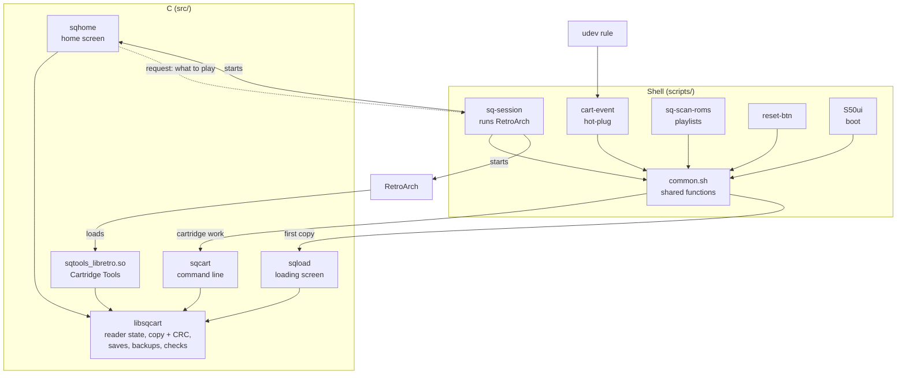
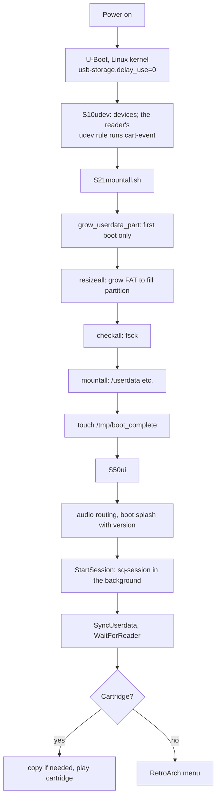
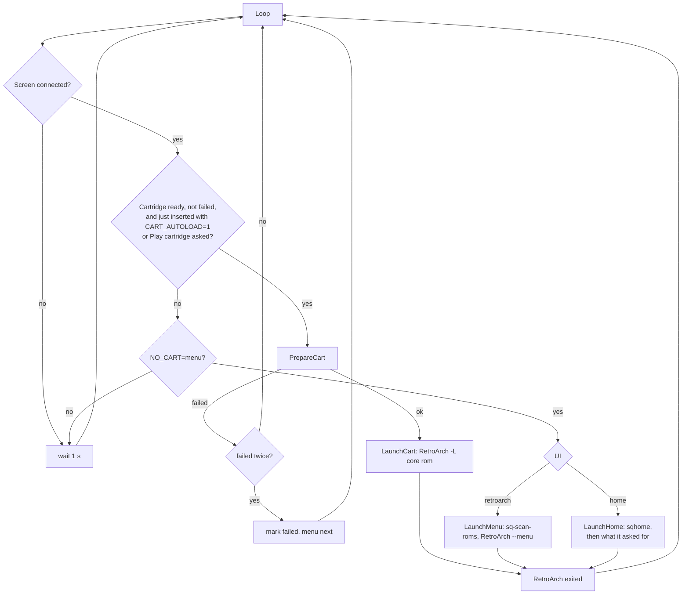
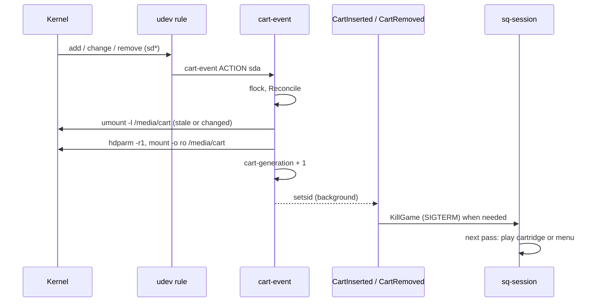
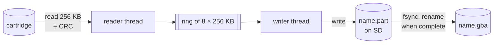
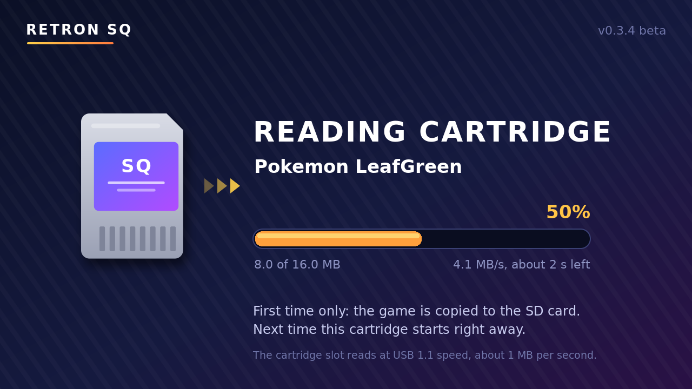
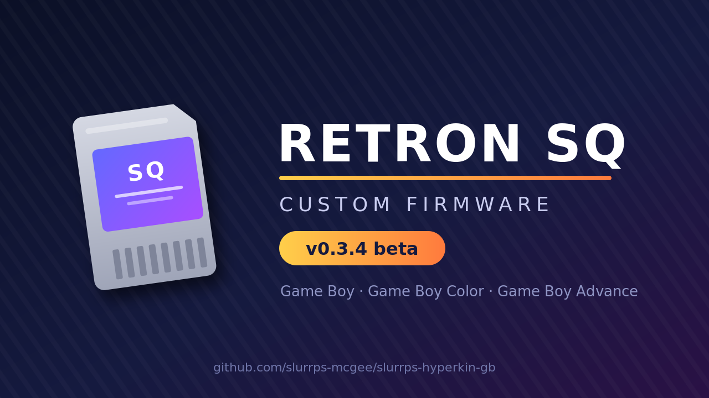

# Retron SQ firmware: how it works

This document explains how the firmware runs games and what each piece of
code does. For installing and playing, see the [README](../README.md). For
changing the firmware (adding settings, tools, cores, screens; building and
testing), see [DEVELOPING.md](DEVELOPING.md).

- [The hardware in brief](#the-hardware-in-brief)
- [The pieces](#the-pieces)
- [Boot sequence](#boot-sequence)
- [The session](#the-session)
- [The home screen](#the-home-screen)
- [Cartridges](#cartridges)
- [Saves](#saves)
- [Cartridge Tools](#cartridge-tools)
- [Choosing an emulator core](#choosing-an-emulator-core)
- [Version and splash screens](#version-and-splash-screens)
- [The SD card](#the-sd-card)
- [The RetroArch menu](#the-retroarch-menu)
- [Events and who handles them](#events-and-who-handles-them)
- [Settings reference](#settings-reference)
- [Logs and troubleshooting](#logs-and-troubleshooting)
- [File reference](#file-reference)
- [Known limits](#known-limits)

---

## The hardware in brief

| Part | Details |
| --- | --- |
| SoC | Rockchip RK3128 (4× Cortex-A7, ARMv7 hard-float, NEON) |
| GPU | Mali-400 MP2: OpenGL ES 2.0, no `highp` in fragment shaders |
| Storage | A microSD card inside the console holds the whole system |
| Video | HDMI only |
| Cartridge slot | A small reader that shows up as a **USB drive** on port `3-1` of the RK3128's OHCI controller (`101e0000.usb`): USB 1.1 Full Speed, about 1 MB/s |
| Controller | Hyperkin SQ USB pad (RetroArch autoconfig `Hyperkin_SQ.cfg`) |
| Software | Buildroot 2018.02, Linux 4.4, glibc 2.26, BusyBox `ash`, SDL 2.0.12, RetroArch 1.7.4 |

The key fact: **the console never runs a cartridge directly.** The reader
exposes the inserted cartridge as a small FAT drive with three files:

| File | Content |
| --- | --- |
| `<name>.gba` / `.gbc` / `.gb` | the cartridge's ROM |
| `<name>.sav` | the cartridge's save memory, if it has any |
| `<name>.crc` | a 4-byte checksum of the ROM (big-endian) |

The firmware copies the ROM to the SD card and runs it in an emulator
(RetroArch with a libretro core). Everything else follows from that.

**The cartridge is only read**, with one deliberate exception: Cartridge
Tools' *Write a save to the cartridge*, which the user asks for. See
[The cartridge is read-only](#the-cartridge-is-read-only).

## The pieces

Everything the firmware adds lives in one Buildroot package,
`buildroot/package/retronsq/`:



- **libsqcart** (`src/lib/`, header `sqcart.h`) is the one implementation
  of cartridge handling: reader state, the reader's CRC, the pipelined
  verified copy, atomic writes, save import, backups and the Gen 3 Pokémon
  save checker. It also holds what the home screen and Cartridge Tools
  share: the cartridge actions as the user sees them (`sq_do_*`), settings
  (`sq_cfg_get`/`sq_cfg_set`) and the game library (scan, history,
  favorites, box art). Every path goes through `sq_path()`, which prefixes
  `$SQ_ROOT`, so tests run it against a sandbox.
- **sqhome**, **sqload**, **sqcart** and **Cartridge Tools** are programs
  on top of it, so the home screen, the shell scripts, the loading screen
  and the tools can't disagree about what a cartridge is or how it's
  copied.
- **The shell scripts** are glue: they decide *when* things happen (boot,
  hot-plug, reset) and run RetroArch.

## Boot sequence



1. **Kernel.** `usb-storage.delay_use=0` (bootargs in
   `kernel/arch/arm/boot/dts/rk3128-brk01.dts`) makes the reader's disk
   appear as soon as it is probed, instead of a second later.
2. **`S21mountall.sh`** (`buildroot/package/rockchip/partinit/`) prepares
   storage. On the first boot from the SD card image it grows the `userdata`
   partition to the end of the card and the FAT32 filesystem with it (see
   [First boot](#first-boot-growing-to-the-whole-card)). It then checks and
   mounts everything, saves the boot's storage log to `logs/boot.log` on the
   card, and creates `/tmp/boot_complete`.
3. **`S50ui`** sets the audio output (HDMI or headphones), shows the boot
   splash (`/etc/retronsq-splash.png`) with `fbv`, and calls `StartSession`.
4. **`sq-session`** takes over (next section). Before its first decision,
   `WaitForReader` gives the reader time to show up, so **a cartridge
   inserted at power-on starts straight away and the menu never flashes
   first.** The boot splash stays up meanwhile.

   The Retron SQ's reader only appears on USB once it has a cartridge and
   has read it (with no cartridge it isn't there at all), which can be
   well after the session starts. So the wait is measured from power-on.
   It polls `sqcart reader-state` every 0.1 s:
   - `ready` (cartridge mounted) ends the wait at once;
   - `pending` (disk with a cartridge, not mounted yet) keeps waiting, up to
     15 s past the deadline, and runs `cart-event reconcile` once a second
     in case the udev event came before anything could handle it;
   - `none` or `empty` only count as "no cartridge" once `CART_WAIT`
     seconds (15) have passed since power-on.

   The trade-off: a higher `CART_WAIT` keeps the splash up longer for a
   slow cartridge, but every boot without a cartridge waits that long too.
   If the reader is slower than `CART_WAIT`, the home screen shows and the
   cartridge takes over as soon as it appears, like a hot-plug.

   Every change of state is logged with its time since power-on
   (`boot: cartridge reader ready at 17.40 s`), then the result. With
   `boot: splash up`, `boot: session started` and `home screen` in
   `launcher.log`, and each storage step's start and end in `boot.log`,
   the whole boot can be timed from the SD card.

## The session

`sq-session` (`scripts/sq-session`) is a loop that keeps **exactly one**
thing on screen (RetroArch or the home screen) for as long as the console
is on:



RetroArch runs in the foreground of the loop. When it exits for any reason
(quit from the menu, stopped by an event, crash), the loop runs again and
picks what should run now.

**Only sq-session starts RetroArch.** Every event handler only *stops*
RetroArch, with `KillGame`, and the loop does the rest:

- *Cartridge inserted during the menu or an SD card game* (with
  `CART_AUTOLOAD=1`): RetroArch is stopped; the next pass finds the
  cartridge and plays it.
- *Cartridge pulled during its game:* RetroArch is stopped; the next pass
  finds no cartridge and opens the menu.
- *Reset button:* RetroArch is stopped; the next pass starts the same thing.

With one place deciding what runs, two events can never start two games at
once.

Details:

- **Stopping RetroArch gracefully.** `KillGame` sends **one** SIGTERM. In
  RetroArch 1.7.4 that is a normal quit: the video driver sees the signal,
  the run loop ends and the game's save is written. A second SIGTERM would
  make it `exit(1)` on the spot without saving, so there is never a second
  one: if RetroArch still runs after 6 s it gets SIGKILL (and it's logged).
  `KillGame` waits only for the pids it signalled, because the session may
  already be starting the next RetroArch.
- **RetroArch's stdin is `/dev/null`.** This RetroArch is built without
  networking, and then 1.7.4's stdin commands (`stdin_cmd_enable`) do a
  *blocking* read every frame and never act on what they read. v0.2.0 gave
  RetroArch a FIFO there and turned the option on, which froze RetroArch on
  its first frame (no menu, and no game after the loading screen); the
  option is now forced off.
- **Single instance.** `StartSession` runs the session under
  `flock -n /run/retronsq/session.lock` and `setsid`. A second call while it
  runs does nothing, and the session outlives the script that started it.
- **Back-off.** If RetroArch exits within 3 s three times in a row (bad core,
  no GPU), the loop sleeps 5 s between tries instead of spinning.
- **Failed cartridges.** If a cartridge fails to load twice (unreadable,
  pulled mid-copy), `/run/retronsq/cart-failed` is set and the menu runs
  instead until a cartridge is inserted again or *Play cartridge* is chosen.
- **`/run/retronsq/mode`** holds `cart`, `game` (from the SD card),
  `home` or `menu`, so a removal only stops RetroArch when it runs the
  cartridge, and the reset button knows what to restart.
- **Auto-load is once per insert.** `LaunchCart` sets
  `/run/retronsq/cart-played`; inserting (or swapping, or pulling) a
  cartridge clears it. So leaving a cartridge's game goes to the home
  screen instead of straight back into the game. The reset button asks for
  the same game again (`play-cart` for a cartridge, `replay` for an SD card
  game).
- **Back-off counts crashes only.** The home screen handing over a request
  resets the quick-exit counter: it's working, not dying.
- **Firmware RetroArch settings.** RetroArch always starts with
  `-c /userdata/retroarch/retroarch.cfg --appendconfig=/usr/share/retronsq/retroarch-cfw.cfg`.
  The second file holds the settings the firmware depends on
  (`stdin_cmd_enable` off, `autosave_interval`), so they hold even on SD
  cards set up by an older firmware or changed in the menu. (RetroArch
  replaces the appended file with a core or game override file when one
  exists, so overrides should not change these two settings.)

## The home screen

`src/home/` (`sqhome`): the start screen with `UI=home` (the default). A
small SDL2 program, built to be light on the RK3128:

- **Draws only when something changed** and otherwise sleeps in
  `SDL_WaitEventTimeout`. No animation loop.
- **Vsync, each frame waited for.** Without vsync, SDL 2.0.12's KMSDRM
  driver queues page flips but never reads the "flip done" events; they
  fill the DRM file's 4 KB event space (`drm_fops.c`) after about 128
  frames, and from then on every flip fails: the screen froze while the
  program ran on (v0.3.0–v0.3.2, "the UI freezes"). Frames presented while
  a flip was pending were dropped too ("shows only when another frame
  follows"). sqhome and sqload now create their renderer with
  `SDL_RENDERER_PRESENTVSYNC` and set `SDL_VIDEO_DOUBLE_BUFFER=1`, so each
  present waits for its own flip and reads its event.
- **Nothing slow on the main thread.** A poller thread looks at the slot
  twice a second (`sq_cart_scan`, the reader state, write protection, what
  writing to the cartridge did, the `.crc`, and a pending write check, which
  reads the cartridge's save) and wakes the main loop with an SDL event
  when something changed. Settings are saved by a saver thread (quick
  changes coalesce; leaving the home screen waits for it), so a button
  never waits for the SD card. Favorites are kept in memory.
- **Text is cached:** every rendered string is kept as a texture (128
  entries, least recently used dropped), keyed by the width it was fitted
  to, so a hit costs no FreeType call at all (not even measuring).
- **Slow moments are logged:** a button or a frame that takes over 250 ms
  goes to `launcher.log` ("home: slow: ..."), up to 20 times per run.
- **Box art loads lazily:** only for the selected game, 150 ms after the
  cursor stops, one image held at a time (`sq_boxart_path`). First a PNG
  next to the game with its name (`roms/gba/Golden Sun.png`), else
  RetroArch's own layout,
  `retroarch/thumbnails/<system>/Named_Boxarts/<label>.png` with
  `` &*/:`<>?\| `` in the name replaced by `_`, so libretro-thumbnails packs
  work unchanged.
- **1280×720 logical size**, scaled by SDL to the screen. On the console:
  KMSDRM and GLES2, HDMI chosen with `SDL_MONITOR_INDEX=1` (like `sqload`);
  software rendering if GL fails.

**Pages** (left): Cartridge, Recently played, Favorites, Game Boy Advance,
Game Boy Color, Game Boy, Cartridge dumps, Settings. It opens on the
Cartridge page when a cartridge is in, else on Recently played (or Game
Boy Advance when nothing was played yet).

| Data | Where |
| --- | --- |
| Games | `sq_library_scan`: `roms/` recursively (system from the extension, a `.zip` by its folder), sorted by name; `rom/` for Cartridge dumps |
| Recently played | `home/history.txt` (`path<TAB>label`, newest first, 30 kept). sqhome adds a game when it starts it; `LaunchCart` adds cartridges with `sqcart history-add` |
| Favorites | `home/favorites.txt`, toggled with Y |
| Settings | `retronsq.cfg` through `sq_cfg_set`: the line is replaced in place, the rest of the file and its comments kept |

Entries whose file is gone are skipped, so games deleted on a PC disappear
by themselves.

**Starting things.** The home screen never starts anything itself. It
writes `/run/retronsq/home-request`:

```
ACTION=game
ROM=/userdata/roms/gba/Golden Sun.gba
LABEL=Golden Sun
```

and exits. sq-session's `RunHomeRequest` then does it: `game` (only a
`.gb/.gbc/.gba/.zip` under `/userdata`, no `..`; core by `CoreForRom` for
`rom/`, the system's otherwise), `cart` (play the cartridge), `retroarch`
(RetroArch's menu), `reboot`, `poweroff`. Games started this way run with
`RETRONSQ_CLOSE_QUITS=1`: RetroArch patch 0004 makes *Close Content* quit
(normally, saving) so the game returns home.

**The splash only at power-on.** The boot splash is drawn on the console
framebuffer, which the display falls back to whenever no program holds
it (between the loading screen and a game, a game and the home screen).
sq-session clears it (`BlankFramebuffer`) 4 s after starting the first
program, so later switches go through black.

**Input.** `input.c` maps pads with RetroArch's own autoconfig files
(`retroarch/autoconfig/*.cfg`, matched by USB vendor/product id, then by
name). RetroArch's udev joypad driver and SDL's Linux joystick code number
buttons and axes the same way, so `Hyperkin_SQ.cfg`'s numbers mean the same
here and both agree. A pad without a file gets a common layout. The
keyboard works too (arrows, Enter, Backspace). Directions and L/R repeat
when held. Each pad event is judged by its own value, not by the pad's
current state: a quick tap's press and release can arrive in one batch,
and reading the state would lose the press.

**Cartridge page.** The same actions as Cartridge Tools (below), from the
same code (`sq_do_*` in `src/lib/actions.c`), run in a worker thread, plus
*Write a game to the cartridge*. Every action reports progress and says
what it counts up to (the totals are in `sqcart.h`), so each shows percent,
KB or MB done, speed and time left (libsqcart's `sq_meter_text`, which the
loading screen and the tools core use too), and the writes also the step
they're on (backing up, writing, reading back). A failed action goes
straight to its message instead of a moment of "Done". On the right, the
cartridge's details: from the scan, the slot's `.crc` (read once per
cartridge), `sq_reader_writable()` and `sq_cart_write_known()`. The slot's
write protection can only say "no": a slot that doesn't report it may
still not pass writes on. So what writing a save and writing a game did is
recorded per cartridge (ROM file name and size) in `home/cart-writes.txt`
when it is known: by the re-insert write check, or by a write that read
back different. The details say *Not tested yet*, *Works (tested)* or
*Doesn't stick (tested)*, and a write option is greyed out, with the reason
under the list, when the slot is write protected or that kind of write
already didn't stick.

**Date and time.** The console has no battery-backed clock, so every boot
started in 1970 and files were dated so. `sqcart clock-restore` (at the
end of `S21mountall.sh`, after userdata is mounted) sets the clock to the
time saved in `home/clock`, or to the firmware's build time
(`/etc/retronsq-version`'s date) if later. sq-session's `ClockKeeper` saves
the time every 5 minutes, and before a restart or power off from the home
screen. Settings > *Date and time* sets it (`settimeofday`, then saves). The
clock runs in UTC; a power-off loses the time it was off.

**Reading cartridge...** The slot connects to USB only once it has read
the cartridge itself (it serves the `.crc` the moment it appears), so
nothing can show earlier: there is no cartridge-detect line (the device
tree's gpio-keys are the d-pad and reset). cart-event logs "cartridge
reader up" (with or without the cartridge ready) when the slot appears.
The cartridge poll (twice a second) looks at `sq_reader_state()`: while it
is `pending` or `empty` (the slot is on USB, no cartridge mounted yet) the
header's top right says *Reading
cartridge...*, redrawn every 400 ms for its dots, then the cartridge's
name once it is mounted.

**When a cartridge can't be read** the home screen shows a message
(`check_read_error` in the poller): the slot mounted a drive with no game
on it (two polls in a row, once per `cart-generation`), the slot has been
"reading" for 30 s, or a message file left by the scripts:
`$RUN/cart-error.txt` (`CartError` in common.sh), written by `PrepareCart`
when the copy fails (with sqload's reason) and by cart-event when the
drive can't be mounted.

**Saves page and options.** `sq_saves_scan` (`library.c`) lists the live
saves (`.srm` in `roms/` and `rom/`) and the backups in `saves/`, by game.
**Select** on a game opens its options (play, favorite, delete); on the
Saves page A or Select. `sq_delete_game` / `sq_delete_save` only delete game
files under `roms/` and `rom/` (a cartridge copy's `.crc` goes too) and
saves under `roms/`, `rom/` and `saves/`; anything else, or a path with
`..`, is refused. A live save is asked about twice.

**Dialogs** have real buttons: questions *No* and *Yes* (or *Write it*),
picked with Left/Right and pressed with A, with *No* selected first; B is
always *No*. Messages have an *OK* button. The tools core does the same on
its small screen.

**First frames.** On the console's display (KMSDRM, Mali) a frame only
shows once more frames follow, and this screen otherwise draws once and
sleeps. So every change is presented three times, 33 ms apart, and for the
first 1.5 s after the home screen starts (the TV may still be switching
mode after RetroArch) a frame is presented every 100 ms. Inserting a cartridge with auto-load on stops the home screen
(one SIGTERM, like RetroArch) so the cartridge starts.

**Stopping.** SIGTERM (KillGame) ends it at once; an action in progress is
finished first. SDL's shutdown gets 5 s.

## Cartridges

### Hot-plug



The stock firmware used `usbmount`, which mounts any USB disk on the first
free `/media/usbN` and only reacts to `add` and `remove`. Swapping a
cartridge with the console on left the old mount behind (busy at removal, or
never removed because the reader only reported a *media change*). The
directory still listed the old cartridge from cache while every read
failed, which is how "Copy failed" happened in Cartridge Tools.

The firmware replaces it with **`cart-event`** (`scripts/cart-event`):

- **One udev rule** (`udev/90-retronsq-cart.rules`) matches only the
  reader's port (`DEVPATH` under `101e0000.usb/usb3/3-1/3-1:1.1/`), sends
  every `add`, `change` and `remove` to `cart-event`, and sets
  `events_poll_msecs=1000` on the disk. The kernel's default media polling
  is off, so without it a reader that stays connected never reports a
  cartridge swap.
- **Reconcile, don't track.** Whatever the event, `cart-event` looks at what
  the reader has *now* (its disk under the port in sysfs, the disk's size:
  0 means no cartridge) and makes `/media/cart` match. A mount of the wrong
  device, of a device that's gone, or of a medium that just changed
  (`DISK_MEDIA_CHANGE=1`) is dropped with `umount -l`, so a program still
  holding a file can't keep a stale mount alive. A cartridge is always
  mounted at the **same path**, `/media/cart`.
- **Read-only** twice over: `hdparm -r1` on the reader's disk, then
  `mount -o ro,noexec,nodev,noatime`.
- **One at a time.** An insert fires several events at once; a `flock`
  serialises them, and the second finds nothing to do.
- **Generation counter.** Every change bumps `/run/retronsq/cart-generation`.
  libsqcart records it when it scans a cartridge, and `sq_cart_still_there()`
  checks it (plus the mount and the ROM's size) before and after every copy.
  A cartridge swapped during a copy is reported as such instead of producing
  a mix of two games.
- **Then it tells the session**, in the background so udev isn't held up:
  `CartInserted`, `CartRemoved`, or `CartInserted swapped` when one event
  covered both. A swap does what a removal does to the old cartridge's game
  and what an insert does for the new one, but stops RetroArch only once
  (a second stop could hit the RetroArch the session starts for the new
  cartridge).

**`CART_AUTOLOAD`** (default 1) decides what an insert does. With 1,
RetroArch is stopped and the cartridge starts. With 0, nothing changes: the
cartridge is mounted and ready in Cartridge Tools (*Play cartridge*), and a
cartridge game still stops when its cartridge is pulled or swapped.

libsqcart's reader state (`sq_reader_state()`, `sqcart reader-state`):

| State | Meaning |
| --- | --- |
| `none` | no reader on the USB port |
| `empty` | reader there, no cartridge (disk size 0) |
| `pending` | cartridge there, not mounted yet |
| `ready` | mounted at `/media/cart`, and the mounted device still exists with a medium |

Only `ready` counts as a cartridge, so even a stale mount that slipped
through is never treated as one.

### From slot to screen

`PrepareCart` (in `common.sh`) makes sure `/userdata/rom/` holds a good copy
of the inserted cartridge:

1. **Cache check** (`sqcart cache-valid`, `sq_cache_valid()`). If
   `/userdata/rom/<name>` has the cartridge's size and a `.crc` identical to
   the reader's, the cartridge hasn't changed since it was copied, and the
   copy is used directly. This is the common case: a cartridge played before
   starts in moments. `VERIFY_CACHE=1` also recomputes the copy's CRC.
2. **Otherwise `sqload` copies it** behind the loading screen.
3. **Saves.** `sqcart import-save` copies the cartridge's `.sav` to
   `<name>.srm` only if there is no `.srm` yet; `sqcart backup-save` backs
   it up to `saves/<name>/` if it's new (see [Saves](#saves)).

`LaunchCart` then runs `retroarch -L <core> /userdata/rom/<name>`.

### The cartridge is read-only

Two independent locks keep anything from writing to a cartridge:

1. **Block device.** `cart-event` runs `hdparm -r1` on the reader's disk
   (and the partition, if the cartridge is mounted from one: on this
   kernel the flag is per block device) before mounting. The kernel then
   refuses every write to it, whoever tries.
2. **Mount.** `/media/cart` is mounted `ro`.

Nothing in the firmware writes there, except two functions in
`src/lib/cartwrite.c`: `sq_write_cart_save` for *Write a save to the
cartridge* and `sq_write_cart_rom` for *Write a game to the cartridge*.

### Writing a save to the cartridge (experimental)

The stock firmware never wrote to cartridges, and whether the reader's
firmware passes writes to its FAT drive on to the cartridge's save chip is
unknown. So the write is opt-in, checked at every step, and logged:

1. **Write protection.** Before `cart-event` first locks a newly attached
   drive, it records the drive's own read-only flag in
   `/run/retronsq/reader-wp` (the kernel sets it when the device reports
   write protection) and logs it. A write-protected reader is refused.
2. **Checks that change nothing:** the save must be exactly the size of
   the cartridge's `.sav`, and a Gen 3 Pokémon save must have a valid slot.
3. **Backup:** the cartridge's current save is backed up
   (`sq_backup_cart_save`) before anything is unlocked.
4. **Unlock:** `cart-event write-enable` clears the read-only flags and
   remounts `/media/cart` read-write, under the same lock as hot-plug
   events.
5. **Write in place:** `sq_write_cart_save` opens the `.sav` without
   truncating and overwrites it with the same number of bytes, then
   fsyncs. No new file, no size change: the drive's FAT and directory stay
   as they are, only the save file's data sectors are written.
6. **Lock:** `cart-event write-disable` syncs, remounts read-only and sets
   the read-only flags again. A mount that can't be switched back is
   replaced by a fresh read-only one (same device, so no insert or removal
   is reported).
7. **Check:** the save is read back with `O_DIRECT` (or with its cached
   pages dropped), so what is compared is what the reader returns.

Every step goes to `launcher.log` (`tools:` and `cartridge:` lines).

8. **Checked again at re-insert.** The read-back in step 7 can be answered
   from the reader's own memory: it proves the slot took the write, not
   that the cartridge has it. So a successful write is remembered in
   `home/cart-write-check` on the SD card (ROM name and size, save size and
   CRC; it survives a power-off) and the user is told to take the
   cartridge out and put it back. The next time that cartridge is
   inserted, `sq_write_check` compares its save: "Your save is on the
   cartridge" or "The cartridge still has its old save". The session runs
   it in `PrepareCart` (`sqcart write-check`, logged as `write check:`
   lines; the home screen shows the verdict when it next opens), and the
   home screen runs it itself when a cartridge appears on it.

### Writing a game to the cartridge (experimental)

The same steps as a save (`sq_do_write_rom` in `actions.c`): write
protection, checks that change nothing (`sq_cart_rom_fits`: `.gba` for a
GBA cartridge, `.gb`/`.gbc` for a GB one, no `.zip`, no bigger than the
cartridge's game file, which can't grow on the slot's drive), backup of the
cartridge's save, `write-enable`, `sq_write_cart_rom`, `write-disable`.
`sq_write_cart_rom` streams the game over the start of the cartridge's game
file in 64 KB steps, in place, fsyncs, then reads it back past the page
cache and compares it with the file; a difference after the start is
reported as "part of it was written". Whether the slot's firmware turns
these writes into flash programming on a rewritable cartridge is unknown
(an original cartridge's mask ROM can't change).

The re-insert check (`sq_write_check_remember_rom`) differs from a save's:
the slot names the cartridge's file after its game, so the cartridge may
come back under the new name. The record (`KIND=rom`) keeps the CRC of the
first 64 KB written; whatever cartridge is inserted next is compared:
match = "The game is on the cartridge", the old game (same name and size) =
"still has its old game", another cartridge = not this check's.

### The copy

`src/lib/copy.c` (`sq_copy`), used by `sqload`, `sqcart cache` and
Cartridge Tools:



- **Two threads overlap the work.** The reader fills 256 KB slots from the
  cartridge and the writer writes them to the SD card. Neither waits unless
  the ring is full or empty. The stock tool did synchronous 1 KB pairs.
- **The CRC is computed while reading**, so verifying costs no second pass.
- **Atomic result.** Data goes to `<name>.part`, which is fsynced and
  renamed only once complete. A cartridge pulled mid-copy leaves no
  truncated ROM.
- **Verification** (`sq_cache_cartridge`, `check_copy` in `cart.c`). If the
  CRC doesn't match the reader's `.crc`: (1) `sq_crc_probe` (`crc.c`)
  computes 16 CRC-32 variants of the SD copy in one pass and compares each
  with the `.crc` in both byte orders; a match is trusted
  (`SQ_VERIFIED_CRC`), logged ("checksum probe") and remembered in
  `home/crc-variant`. Every genuine cartridge so far mismatched the stock
  algorithm, so the logs will show which one the slot uses. (2) Otherwise
  `sq_sample_check` reads 32 × 32 KB spread over the game straight from the
  cartridge (`sq_open_uncached`: O_DIRECT, or the page cache dropped) and
  compares them with the copy; identical is trusted (`SQ_VERIFIED_TWICE`).
  Up to v0.3.3 the second, full read came out of Linux's page cache (4 s
  instead of 60 s for 16 MB), so it compared the first read with itself.
  (3) Samples that differ: the page cache is dropped (`sq_drop_cache`) and
  the whole cartridge is read again; the same CRC twice is trusted. It gets a cached `.crc` like a
  matching copy, so it isn't read again on every insert. Only when the two
  reads differ is the ROM kept unverified (so the game runs), **without** a
  cached `.crc`, so the next insert reads the cartridge again. If the
  cartridge turns out to be gone after an unverified copy, the copy is
  deleted: nothing vouches for its data. Every mismatching read is logged
  to `launcher.log` with both CRCs and the ROM size.
- **Space** (`make_room`). If the SD card is too full, old cartridge copies
  in `/userdata/rom` are deleted, largest first. Saves and save states are
  never deleted.
- **Errors** say what failed and why (`struct sq_error`: step, file and
  `strerror`), e.g. "the cartridge was removed while it was being read".

### The loading screen

The first read of a cartridge is slow because of the hardware: the reader
is a **USB 1.1 Full Speed** device. USB storage at 12 Mbit/s reads about
0.8–1 MB/s, so a 16 MB GBA game takes about 16–20 s and a 32 MB one 35–40 s,
whatever the software does. The firmware reads each cartridge only once,
and tells the user what's happening:



`sqload` (`src/load/sqload.c`):

- **The copy starts first**, in a thread, then the screen (SDL, EGL, PNG
  decode) is set up while data is already flowing. The screen is cosmetic:
  without a display, or if SDL fails, the copy still completes and the exit
  status still says whether it worked.
- **Background:** `/etc/retronsq-loading.png`, rendered at build time from
  `splash/retronsq-loading.svg`. It holds the heading, the explanation and
  the empty progress bar track.
- **Live parts** (`draw_loading`): the game's name, the bar, the
  percentage, "MB of MB" and the time left, in DejaVu Sans via SDL_ttf. Each
  text line is only re-rendered when it changes. The time left comes from
  the measured speed once 1.5 s of data has arrived.
- The renderer uses a 1280×720 **logical size**, so the code draws in the
  SVG's coordinates (`LOADING_*` at the top of `sqload.c`, listed in the
  SVG's comment) and SDL scales to the real screen. It draws on the HDMI
  output (`SDL_MONITOR_INDEX=1`, Rockchip's SDL patch). If OpenGL isn't
  available it falls back to the software renderer.
- **Watchdog** (its own thread, so nothing on the screen side can block
  it). If no data comes from the cartridge for 30 s, sqload gives up with
  a failure (a read stuck in the kernel can't be interrupted); sq-session
  then tries once more and shows the menu, instead of a frozen loading
  screen. Once the copy is done, the screen (SDL setup, drawing, shutdown)
  gets 10 s to let go, then sqload exits anyway with the copy's result.
- **Its messages go to `launcher.log`** (`sqload:` lines): copy time,
  whether the checksum verified, how long the screen took to come up, and
  why it failed if it did.
- `SQ_LOADING_SNAPSHOT=<prefix>` saves `<prefix>-50.bmp` and
  `<prefix>-100.bmp` screenshots (used by the tests).

### The reader's CRC

`src/lib/crc.c`: CRC-32 with polynomial `0x04C11DB7`, not reflected,
computed over 512-byte blocks, with the running value **inverted after
every block**. That last quirk makes it different from every standard
CRC-32. The unit tests check it against an independent implementation of the
stock `hyperkin-crc` algorithm. `sqcart crc FILE` prints it.

### Reproduction and flash carts

Reproduction carts are copied like any cartridge. Their usual problem is the
save chip: they often use a different chip than the original game, and the
default GBA core (gpSP) picks the save type from a database of real games.
mGBA detects it from the ROM instead, so `cart-overrides.txt` can switch a
single cartridge to mGBA.

Menu-based flash carts (EverDrive, EZ-Flash) can't work. The copy contains
the flash cart's menu program, and in the emulator there's no flash cart
hardware (SD slot, FPGA, mapper) behind it. Single-game flash carts copy fine.

## Saves

All saving happens on the SD card:

| File | Role |
| --- | --- |
| `rom/<game>.srm` | **The live save** of a cartridge game. RetroArch reads and writes it (`savefile_directory` is empty, so saves go next to the game). |
| `rom/<game>.state*` | Save states, same place |
| `saves/<game>/NNN-<kind>.sav` | Backups: `cartridge` (taken from the cartridge), `before-restore` (the live save replaced by a restore) |
| `roms/<system>/<game>.srm` | Saves of games played from the SD card library |

The rules:

- **First play:** the cartridge's save is copied to `rom/<game>.srm`
  (`sq_import_save`). After that the cartridge's save is never used again on
  its own, so the SD card's save can't be overwritten by the cartridge. A
  cartridge save of an implausible size is still imported (so the game has
  its save) but logged as a warning, and a truncated Gen 3 Pokémon save is
  flagged.
- **Every play:** `sq_sync_cart_save` (`sqcart sync-save`, in
  `PrepareCart`) makes `saves/<game>/cartridge.sav` a copy of the
  cartridge's save, rewriting it only when it differs, and deletes backups
  that are byte-identical to an older backup (left by v0.2–v0.3.2, which
  backed up on every insert; the oldest copy stays).
- **Backups** (`NNN-<kind>.sav`, `sq_backup_store`, never stored twice) are
  made when the user asks (*Back up cartridge save*: `cartridge`) and
  before the firmware overwrites a save: a restore (`before-restore`) or a
  write to the cartridge (`before-write`).
- **Going back to the cartridge's save, or an older one:** Cartridge Tools →
  *Restore a save...*. It backs up the live save, then replaces it.
- **Writes are atomic.** Everything the firmware writes goes to a temporary
  file that is fsynced and renamed when complete, and then the folder is
  fsynced (`sq_write_atomic`, `sq_sync_dir`). That last step matters on the
  FAT card: a rename otherwise stays in memory for up to 30 s (the kernel's
  dirty writeback), and a console switched off in that time comes back with
  the old file; that is how settings were lost up to v0.3.2. RetroArch 1.7.4
  itself truncated the `.srm` and rewrote it in place without fsync, so a
  power cut during a save could destroy it; the firmware's RetroArch patch
  `0003-tasks-write-save-RAM-atomically.patch` makes its autosave and its
  save-on-exit write `<save>.tmp`, fsync, rename and fsync the folder too.
- **Autosave every 2 s.** `autosave_interval = 2` (in
  `retroarch-cfw.cfg`): an in-game save reaches the SD card within about
  2 seconds, so switching the console off soon after saving keeps it. Only
  changed save RAM is written.
- **Stops are graceful.** Inserting a cartridge, pulling one, the reset
  button and shutdown all stop RetroArch with a single SIGTERM, which
  writes the save before exiting.

### Gen 3 Pokémon save check

`sqcart check-save FILE CODE` (`sq_gen3_check`) understands the save layout
of Ruby, Sapphire, Emerald, FireRed and LeafGreen (game codes `AXV`, `AXP`,
`BPE`, `BPR`, `BPG`): two slots of 14 sectors of 4 KB; each sector's footer
at `0xFF4` holds a section id, a 16-bit checksum (32-bit word sum over the
data, folded), the signature `0x08012025` and a save counter. It reports,
for each slot, whether all 14 sections are present with valid checksums and
signatures, and which slot the game will load (the valid one with the
higher counter):

```
SAVE_SIZE=131072
SIZE_OK=1
GEN3_TRUNCATED=0
GEN3_SLOTA=valid counter=812 sections=14 bad_checksums=0 bad_signatures=0
GEN3_SLOTB=valid counter=813 sections=14 bad_checksums=0 bad_signatures=0
GEN3_LOADS=B
```

The session logs this for the cartridge's save and the live save before and
after every run (see [Logs](#logs-and-troubleshooting)). If the game says
"The save file is corrupted" while both slots check valid, the save itself
is fine and the emulator's save type is the suspect; if the cartridge's own
save checks bad, the cartridge (or its read) is.

## Cartridge Tools

The cartridge actions are in libsqcart (`src/lib/actions.c`: what each
does, in which order, and the lines telling the user how it went), shown
by two front ends: the home screen's Cartridge page, and, for `UI=retroarch`,
`src/tools/sqtools.c`.

RetroArch 1.7.4 has no plugin or script hooks for its menu, and patching its
menu code is invasive. So the RetroArch version of the tools is a
**libretro core**: RetroArch loads it like a game, and it draws its own
screen (320×240, RGB565, RetroArch's RGUI font) and reads the pad.

- **Opening it.** `sq-scan-roms` writes a one-entry playlist, *Cartridge
  Tools*. It points at `/usr/share/retronsq/cartridge-tools.sqt` with
  `sqtools_libretro.so` as the core. The `.sqt` file only exists so the
  playlist has something to "load".
- **Screens:** main menu, restore list, confirmation, progress bar, result
  message. Unavailable actions are greyed out (no cartridge, or no save on
  it). The cartridge is re-scanned twice a second, so the screen follows
  inserts and removals.
- **Swaps are caught.** Every action first checks `sq_cart_still_there()`.
  A cartridge swapped or pulled since the screen last looked gives "The
  cartridge was removed or changed." and a fresh scan, never a failed copy.
- **Work runs in a thread** so the progress bar keeps moving while a large
  cartridge is read. Leaving the core waits for any running copy to finish.

| Action | Implementation |
| --- | --- |
| Play cartridge | Tools core: writes `/run/retronsq/play-cart`, clears `cart-failed`, and sends RetroArch SIGTERM (a clean exit). Home screen: the `cart` request. Either way sq-session plays the cartridge, even with `CART_AUTOLOAD=0`. |
| Copy cartridge to SD card | `sq_dump_to_library`: copies the ROM to `roms/<system>/<name>`, verified against the reader's CRC (a mismatch is read again; two identical reads are trusted, see *The copy*). A trusted copy in `rom/` is used as the source when there is one (same data, much faster). If the library already has that game (same size, and the slot's CRC or the same data as the trusted copy or this read), nothing is copied. A different game with the same name becomes `<name> (2)`. The save comes along as `<name>.srm` (the live save if there is one, else the cartridge's). Then `sq-scan-roms` runs so it shows in Collections at once. |
| Back up cartridge save | `sq_backup_cart_save`: `saves/<game>/NNN-cartridge.sav`, unless an identical backup exists. |
| Restore a save... | Lists the cartridge's current save and every backup, newest first. On confirm, `sq_restore_save` backs up the live save as `NNN-before-restore.sav` (if not already backed up), then writes the chosen save as the live save. |
| Write a game to the cartridge... | Home screen only. Experimental. Lists the games in `roms/` that fit (`sq_cart_rom_fits`); asks twice. Then the steps in [Writing a game to the cartridge](#writing-a-game-to-the-cartridge-experimental). |
| Write a save to the cartridge... | Experimental. Greyed out when the slot reports write protection. Lists the live save and every backup; asks twice. Then the steps in [Writing a save to the cartridge](#writing-a-save-to-the-cartridge-experimental). `cart-event` is run as `CART_RW_CMD`, which the tests replace. |
| Back to RetroArch menu | `RETRO_ENVIRONMENT_SHUTDOWN`. With `load_dummy_on_core_shutdown` on, RetroArch returns to its menu. |

Restoring only changes the save used when playing **from the cartridge**
(`rom/`). A game copied into `roms/` has its own save next to it.

## Choosing an emulator core

`CoreForRom` picks the core for a cartridge, first match wins:

1. `cart-overrides.txt`: `<ROM file name>=<core>`
2. `gb.txt`: Hyperkin's list of games that need mGBA
3. the system default from `retronsq.cfg`: `GBA_CORE` (default `gpsp`),
   `GBC_CORE` and `GB_CORE` (default `vbam`)

`ResolveCore` turns a short name into a path, checking
`/userdata/retroarch/cores/<name>_libretro.so` first and then
`/usr/lib/libretro/`. So a core copied onto the SD card overrides the built-in
one, and any armhf libretro core (e.g. `gambatte`) can be named. Names come
from files edited on PCs, so `ValidCoreName` only accepts letters, digits,
`_` and `-` (or a full path inside one of the two core folders); anything
else is logged and ignored. If the configured core doesn't exist, the stock
choice is used.

| Built-in core | Systems | Notes |
| --- | --- | --- |
| `gpsp` | GBA | fast; default for GBA |
| `mgba` | GBA, GB, GBC | more accurate and better save detection, slower |
| `vbam` | GB, GBC, GBA | default for GB/GBC |

SD card games in the Collections lists use the system defaults. Games
browsed through *Start directory* use whatever core you pick there.

## Version and splash screens

The firmware version lives in the `VERSION` file at the top of the tree
(`RETRONSQ_VERSION` in the environment overrides it; the release workflow
sets it). While the major version is 0, " beta" is added: `0.3.4` is shown as
**v0.3.4 beta**.

A Buildroot finalize hook in `retronsq.mk` (`RETRONSQ_INSTALL_VERSION`)
runs on every build:

- writes `/etc/retronsq-version` ("Retron SQ CFW v0.3.4 beta"), printed at
  boot and shown by the home screen and Cartridge Tools;
- fills `@VERSION_LABEL@` into the two SVG templates in
  `buildroot/package/retronsq/splash/` and renders them with `rsvg-convert`
  (from the build container, with its DejaVu fonts) to
  `/etc/retronsq-splash.png` (boot splash) and `/etc/retronsq-loading.png`
  (loading screen background), both 1280×720.



`S50ui` shows the splash with `fbv -e`, which scales it up on 1080p screens.
The SD card image is named after the version too:
`RetronSQ-CFW-v<version>-sdcard.img`.

## The SD card

### Layout

The SD card image (`build_sdcard` in `device/rockchip/common/build.sh`):

| Location | Content |
| --- | --- |
| sector 64 | `idbloader`: DDR init + miniloader, found by the RK3128 boot ROM |
| p1 `uboot` | U-Boot |
| p2 `trust` | trusted OS (OP-TEE) |
| p3 `boot` | kernel + device tree (`zboot.img`) |
| p4 `rootfs` | the system, read-only squashfs. Fixed partition GUID `614e0000-...`, which is how the kernel finds it |
| p5 `userdata` | FAT32, label `RETRONSQ`: games, saves, settings |

### First boot: growing to the whole card

The image's `userdata` partition is only about 65 MiB, so one image fits
every card. On first boot `S21mountall.sh` does:

1. **`grow_userdata_part`.** If `userdata` is the last partition and more
   than 16 MiB of the card is unused after it, it uses `sgdisk` to move the
   backup GPT to the real end of the card. It then recreates the partition
   with the **same start sector** (`-a 1`, no realignment), type, unique
   GUID and name, ending at the end of the card. `partx` tells the kernel
   the new size; if that fails, the console reboots once. Every step logs
   what it found and why it stopped ("grow: ..." lines in `logs/boot.log`).
2. **`resize_fat`.** If the FAT32 filesystem is more than 16 MiB smaller
   than its partition (it reads the size from the boot sector with
   `hexdump`: the console's BusyBox `od` has no offset options, which kept
   v0.1–v0.2.1 from ever expanding it) and is no bigger than 256 MiB (the
   image's is 64 MiB; a bigger FAT was made on a PC and is never rebuilt),
   `expand_fat` runs `fsck.fat -a`, copies its files to RAM (`tar` into
   `/tmp`, only if they fit with 8 MiB to spare), formats the whole
   partition FAT32 and puts them back, logging how many files and folders
   came back. A completely blank partition is formatted. Anything else
   unreadable is left alone. Every decision is logged ("fat: ..." and
   "expand: ..." lines).

   **Why every card stayed at 64 MiB up to v0.3.3:** `do_resize` passed
   `$DEV $MOUNT_POINT $PART_NAME $MAX_SIZE` unquoted. Right after
   `grow_userdata_part` regrows the partition (`partx`), its uevent has no
   `PARTNAME`, so the empty name vanished, the size became the third
   argument, `resize_fat`'s size was empty, and its "already big enough"
   test returned silently (boot.log: "partition  bytes"). The arguments are
   quoted now, the name falls back to `/dev/block/by-name/`, and
   `resize_fat` reads the size from sysfs itself when it isn't passed. (Up
   to v0.3.2 a filesystem holding more than 32 MiB was also never
   expanded.)

There is no reliable in-place FAT resizer, which is why it rebuilds. The
`grow` tests run the real `expand_fat` (the console's BusyBox, the real
`mkfs.fat`; mount and umount moved onto mtools) on a 64 MiB image holding
40 MB of files, in 128 and 512 MiB partitions, and check every file comes
back unchanged. They also run it the way the console does, through
`/etc/fstab` and `do_resize`, with no `PARTNAME` in sysfs, on 32 GiB and
128 GiB partitions. Cards of 32, 64 and 128 GB get FAT32 with 32 KB
clusters (`mkfs.fat`'s choice); `fsck.fat` at every boot reads the whole
FAT, so on big cards the "check" time in boot.log grows a little.

Rockchip's `61-sd-cards-auto-mount.rules` (mount any FAT partition of an
SD card at `/mnt/sdcard`) is not installed: the console's only SD card is
its system card, and the rule grabbed `userdata` during udev start-up,
before it could be expanded, and without the `flush` option.

### Contents

The factory contents come from `device/rockchip/userdata/userdata_brk01/`,
built into a FAT32 image by `device/rockchip/common/mk-userdata.sh`. A copy is
also installed in the system at `/usr/share/retronsq/userdata`, and at every
boot `SyncUserdata` puts back any factory file missing from the card. Existing
files are never overwritten. It also copies the built-in cores into
`retroarch/cores` so RetroArch's *Load Core* lists them. This is redone only
when the firmware's cores change, tracked by a checksum in
`retroarch/cores/.builtin-stamp`.

The partition is mounted with `flush`, so writes reach the card quickly,
because the console is usually switched off by pulling the power.

## The RetroArch menu

Menu driver: RGUI (fits the Mali-400). Changes from the stock
`retroarch.cfg`:

| Setting | Value | Why |
| --- | --- | --- |
| `input_menu_toggle_gamepad_combo` | `4` (Start + Select) | open the menu from the pad (stock: `0`, keyboard only) |
| `rgui_browser_directory` | `/userdata/roms` | *Start directory* opens the games folder |
| `savefile_directory`, `savestate_directory` | empty | saves next to each game (see above) |
| `system_directory` | `~/retroarch/system` | BIOS files in a tidy folder |
| `menu_show_core_updater`, `menu_show_online_updater` | `false` | no network on this console |
| `autosave_interval` | `2` | also forced by `retroarch-cfw.cfg` |
| `stdin_cmd_enable` | `false` | also forced by `retroarch-cfw.cfg`; on, it freezes this RetroArch (see above) |

RetroArch 1.7.4 in RGUI shows playlists under **Load Content → Collections**.
`sq-scan-roms` writes them to `retroarch/playlists/` every time the menu
opens:

- `Nintendo - Game Boy.lpl`, `... Color.lpl`, `... Advance.lpl` come from
  `roms/`, sorted by name. The system is taken from the file extension (any
  case). A `.zip` goes by the name of its folder. Hidden files, such as
  macOS's `._*`, and names containing a tab are skipped.
- `Cartridge Dumps.lpl` comes from `rom/`, using the same core each
  cartridge gets in the slot.
- `Cartridge Tools.lpl`, see above.

1.7.4 uses the old playlist format, six lines per game: path, label, core
path, core name, `DETECT`, playlist name. A playlist is only rewritten when
it changed, and removed when it would be empty.

Shaders: 17 single-pass GLSL presets from libretro's `glsl-shaders`
(`retroarch/shaders/`, with their origin in `SOURCE.txt`). They are picked to
compile on the Mali-400: no forced `highp` in fragment shaders, light enough
for 720p.

## Events and who handles them

| Event | Detected by | Runs | Effect |
| --- | --- | --- | --- |
| Boot | init | `S50ui` → `StartSession` | session starts, waits for the reader |
| Cartridge inserted | udev (`add`, or `change` with a media change) | `cart-event` → `CartInserted` | mounted at `/media/cart`; with `CART_AUTOLOAD=1` RetroArch or the home screen stops and the cartridge plays |
| Cartridge swapped | udev | `cart-event` → `CartInserted swapped` | remounted; the old cartridge's game stops; then as an insert |
| Cartridge removed | udev (`remove`, or `change`) | `cart-event` → `CartRemoved` | unmounted; a copy in progress is aborted; RetroArch stops if it ran the cartridge; the menu opens |
| Reset button | `input-event-daemon` (GPIO key F3) | `reset-btn` → `ResetROM` | the game restarts, cartridge or SD card (cartridge re-read first if `RESET_REDUMP=1`); ignored during a copy |
| Home screen: a game, the cartridge, RetroArch, restart, power off | sqhome | `home-request`, sqhome exits | `RunHomeRequest` does it |
| *Close Content* in a game from the home screen | RetroArch (patch 0004) | normal quit | back to the home screen |
| Cartridge Tools → Play cartridge | sqtools core | play flag + SIGTERM to RetroArch | the session plays the cartridge |
| HDMI plugged/unplugged | udev | `drm-hotplug.sh` | video mode and audio route set; `StartSession` |
| Quit RetroArch from its menu | – | – | the session starts the right thing again |
| Shutdown | init | `S50ui stop` → `StopSession` | session and RetroArch stopped (save written) |

## Settings reference

### `retronsq.cfg` (SD card root)

`KEY=value` lines. Windows line endings, spaces and quotes are fine. Read
with `CfgGet` every time a value is needed, so changes apply the next time a
game starts. Defaults are defined once, in `/usr/share/retronsq/defaults.cfg`
(`config/defaults.cfg`), read by both `CfgDefault` (`common.sh`) and
`sq_cfg_get` (libsqcart). The home screen's Settings page writes the file
with `sq_cfg_set`.

| Key | Default | Meaning |
| --- | --- | --- |
| `GBA_CORE` | `gpsp` | core for GBA cartridges and SD games |
| `GBC_CORE` | `vbam` | core for GBC |
| `GB_CORE` | `vbam` | core for GB |
| `UI` | `home` | start screen: `home` (sqhome) or `retroarch` (RetroArch's menu, as in 0.2) |
| `NO_CART` | `menu` | `menu`: the start screen without a cartridge. `none`: blank screen like stock |
| `CART_AUTOLOAD` | `1` | `1`: an inserted cartridge starts at once (once per insert). `0`: it waits on the Cartridge page |
| `CART_WAIT` | `15` | at power-on, wait for a cartridge until this many seconds after switching on (0–120) |
| `RESET_REDUMP` | `0` | `1`: reset re-reads the whole cartridge |
| `VERIFY_CACHE` | `0` | `1`: re-check a cached copy's CRC on every start (stock behaviour, slower) |
| `VERBOSE` | `1` | detailed RetroArch log (`logs/retroarch.log`, serial console) |

### `cart-overrides.txt`

One `<ROM file name>=<core>` per line, `#` for comments. The file name is
the one in `rom/` after the cartridge was played once.

### `gb.txt`

Hyperkin's own list of ROM file names that must run on mGBA, one per line.

## Logs and troubleshooting

Everything needed for a bug report can be read on a PC, in `logs/` on the
SD card:

| File | Content |
| --- | --- |
| `logs/launcher.log` | Synced to the card after every line, so the last lines before a power cut are kept. The session: boot wait result, cartridge inserted / removed / swapped, copies (with sqload's own timings and checksum result), which game started with which core (and its header title and code), save sizes, checksums and Gen 3 checks before and after every run, the `/userdata` mount line (shows if the card went read-only), RetroArch exits. Kept under 512 KB. |
| `logs/retroarch.log` | RetroArch's own log of the last cartridge run (last 256 KB) |
| `logs/boot.log` | The last boot's storage steps: partition grow, filesystem expand, fsck, mount, `/proc/partitions`, `df` |

A launch in `launcher.log` looks like:

```
[42.10] starting Pokemon_LeafGreen.gba (title 'POKEMON LEAF', code 'BPGE') with gpsp_libretro.so
[42.11]   before cartridge save: 131072 bytes, md5 3f2a9c01be44
[42.13]     GEN3_SLOTA=valid counter=812 sections=14 bad_checksums=0 bad_signatures=0
...
[42.20]   userdata: /dev/mmcblk0p5 /userdata vfat rw,...,flush 0 0
```

On the serial console every script logs with an `sq:` prefix.

**Save problems.** Compare the "before" and "after" lines of a run: if the
live save's checksum doesn't change after playing and saving, saves aren't
reaching the card (look at the `userdata:` line for `ro`). If the
cartridge's save already checks bad, the cartridge's save (or its read)
is the problem; restore an older backup from Cartridge Tools.

## File reference

### Running on the console

`buildroot/package/retronsq/`:

| File | Installed as | Role |
| --- | --- | --- |
| `src/lib/` | (linked in) | libsqcart: `sqcart.h` (API and paths), `common.c` (paths, errors, logs, files, atomic write), `crc.c`, `copy.c` (pipelined copy), `cart.c` (reader state, scan, cache, library copy), `save.c` (import, backups, restore, Gen 3 check), `cartwrite.c` (writing a save or a game to the cartridge, the re-insert check), `actions.c` (the cartridge actions as the user sees them), `config.c` (settings), `library.c` (games, history, favorites, box art, the saves list, deleting) |
| `src/cli/sqcart.c` | `/usr/bin/sqcart` | libsqcart for the scripts |
| `src/load/sqload.c` | `/usr/bin/sqload` | loading screen + first copy |
| `src/tools/sqtools.c` | `/usr/lib/libretro/sqtools_libretro.so` | Cartridge Tools core |
| `src/home/` | `/usr/bin/sqhome` | the home screen: `home.c` (pages), `ui.c` (drawing), `input.c` (pads) |
| `src/tools/bitmap.h`, `libretro.h` | | RGUI font and libretro API header, from RetroArch |
| `src/tools/cartridge-tools.sqt` | `/usr/share/retronsq/` | what the Cartridge Tools playlist entry loads |
| `scripts/common.sh` | `/usr/lib/retronsq/` | shared shell functions: paths, settings, cores, launching, event handlers |
| `scripts/sq-session` | `/usr/lib/retronsq/` | the session loop |
| `scripts/cart-event` | `/usr/lib/retronsq/` | cartridge hot-plug |
| `scripts/sq-scan-roms` | `/usr/lib/retronsq/` | Collections playlists |
| `scripts/reset-btn` | `/usr/lib/retronsq/` | reset button |
| `scripts/S50ui` | `/etc/init.d/S50ui` | boot: audio, splash, session |
| `udev/90-retronsq-cart.rules` | `/lib/udev/rules.d/` | reader events to `cart-event`, media polling |
| `config/retroarch-cfw.cfg` | `/usr/share/retronsq/` | RetroArch settings the firmware needs |
| `config/defaults.cfg` | `/usr/share/retronsq/` | every setting's default |
| `splash/*.svg` | `/etc/retronsq-*.png` | boot splash and loading screen templates |

Elsewhere:

| File | Role |
| --- | --- |
| `buildroot/package/retroarch/src/` | RetroArch 1.7.4 with the patches applied; `000N-*.patch` next to it record each change |
| `buildroot/package/rockchip/partinit/S21mountall.sh` | partition grow, FAT expand, fsck, mount, boot log |
| `buildroot/package/rockchip/partinit/partinit.mk` | writes the fstab (`userdata` as `vfat`, `flush`) |
| `buildroot/board/rockchip/rk3128/fs-overlay/usr/bin/drm-hotplug.sh` | HDMI hotplug: video mode, audio route |
| `buildroot/board/rockchip/rk3128/fs-overlay/etc/input-event-daemon.conf` | reset button (F3) → `reset-btn` |
| `kernel/arch/arm/boot/dts/rk3128-brk01.dts` | board device tree; kernel command line (`usb-storage.delay_use=0`) |
| `device/rockchip/userdata/userdata_brk01/` | SD card factory contents |

### Building and testing

See [DEVELOPING.md](DEVELOPING.md).

## Known limits

- Saves are never written back to a cartridge automatically: the SD
  card's `.srm` is the save. *Write a save to the cartridge* does it on
  request, and is untested on real hardware.
- Copying a cartridge whose checksum never matches (some reproduction
  carts) to the SD card twice gives two copies, `<name> (2)`: without a
  trustworthy checksum it can't be recognised as already copied.
- Menu-based flash carts can't work (see above).
- The first read of a cartridge runs at USB 1.1 speed (about 1 MB/s).
  Overlapping reads and writes helps a little; the big win is skipping the
  copy for cartridges played before.
- Heavy multi-pass shaders are too slow for the Mali-400.
- RetroArch's online updater is hidden: the console has no network.
- The serial port gives a root shell. That needs the console opened, and it
  is how the console is debugged, so it stays.
- `BoardConfig_*.mk` variants other than `BoardConfig.mk` still use ext2
  userdata.
